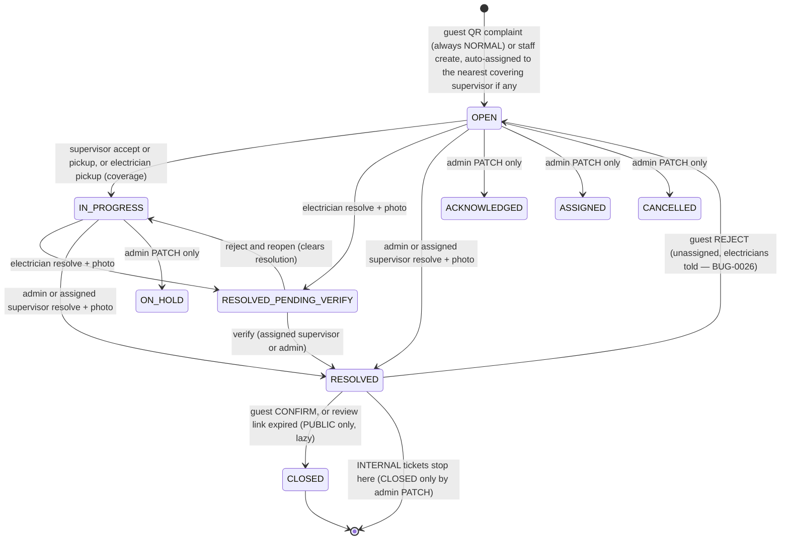
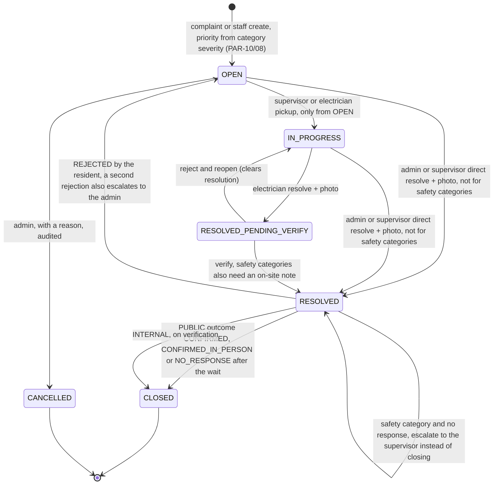
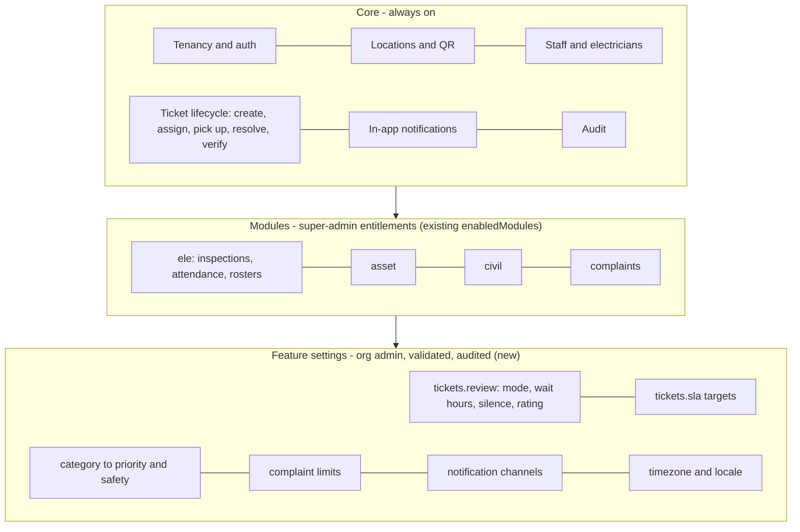
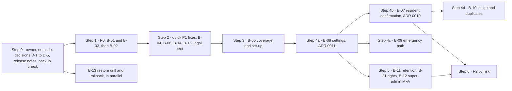

# Product & Architecture Review — 2026-10 (PAR-10)

> **Status: dated snapshot, for discussion.** This is the investigation phase. Nothing in the
> application was changed. It records what the product does today (with evidence), where it
> falls short for a real college or hostel, and the decisions the owner needs to make before
> implementation. Like [`production-readiness-audit-2026-07.md`](production-readiness-audit-2026-07.md),
> it is frozen once accepted: later fixes go in `CHANGELOG.md` and, where architectural, in a
> new ADR — not in edits to this file.

- **Evidence base:** `origin/main` = `0651b26` (tag `v1.0.0`), read 2026-10-23/24. File
  references are `path:line` at that commit (paths relative to the repository root unless
  they start with `src/` or `public/`, which are under `apps/api/`).
- **Finding IDs:** `PAR-10/<n>`. Each finding is exactly one of: **Confirmed implementation**,
  **Confirmed defect**, **Missing functionality**, **Potential risk**, **Product decision**.
  "Confirmed" means established by reading the code (and, where stated, by an existing test or
  a completed CI run). No test was run for this review; every defect fix starts with a red test.
- **Four kinds of statement are kept apart:** *Repository findings* (evidence here), *External
  findings* (§15, cited), *Recommendations* (labelled), and *Assumptions to validate with real
  colleges/hostels* (§16.2).
- **Not production-ready by assertion.** Passing tests do not make it so; see §8 and §10.

---

## 1. Executive summary

**What it is.** A multi-tenant SaaS (one Fastify 5 / Node 24 app, one PostgreSQL, one VM) for
electrical maintenance in institutions. A room's QR code lets anyone report a fault without an
account; the fault becomes a ticket that is auto-assigned to the supervisor covering that
location, rung to the electricians covering it, fixed with a mandatory proof photo, verified
by the supervisor, and — for public complaints — offered to the reporter for confirmation.
Around that core sit daily electrical inspection rounds, attendance and duty rosters, an
asset register with failures and maintenance due dates, alert rules with escalation, AI
summaries, and a super-admin console. Location types include HOSTEL, ICU and WARD: the
product already reaches hospitals as well as colleges and hostels.

**What works well (verified).** Tenant isolation holds across all 37 id-taking mutating staff
routes (`apps/api/test/integration/authz-sweep.test.js`); every query is `orgId`-scoped from
the token; role checks are server-side; the core lifecycle forbids electricians from closing
their own work; the QA system (API suite, Playwright journeys, an explorer that opens every
page as every role, visual and accessibility checks, a production smoke after every deploy and
nightly) is unusually strong for a product this size. Every deploy, nightly e2e and nightly
smoke since 2026-10-17 is green; the only red runs were six e2e runs on PR branches on
2026-10-17, red-first or baseline-creation runs that later went green (§9).

**What does not hold up for a real college or hostel (top items, details in §8/§10):**
1. **P0 — An electrician can confirm the resident's approval themselves.** The electrician
   ticket API returns full ticket rows, including the guest's secret review token and phone
   number (PAR-10/14).
2. **P0 — Supervisors' Aadhaar numbers are stored in plain text** (and copied into audit
   logs), against the Engineering Charter's own rule and the data-model document's claim
   (PAR-10/15).
3. **P0 — An org admin can plant script that runs in a super-admin's browser.** The shared
   escape function leaves quotes unescaped and is used inside HTML attributes with names
   admins type in, and the CSP allows inline handlers (PAR-10/29).
4. **The resident-confirmation step does not reach the resident.** The review link is never
   sent to them; staff must hand it over within 30 minutes, after which silence counts as
   approval; and the resident cannot even see the proof photo on that page (PAR-10/23,
   PAR-10/30).
5. **Auto-assignment can't be configured from the UI.** Nothing in the admin pages assigns
   supervisors to locations, so complaints land unassigned unless rows were created through
   the API (PAR-10/25).
6. **No emergency path.** Every guest complaint is NORMAL priority, including "Short circuit"
   (PAR-10/08); a whole hostel behind one Wi-Fi address shares a budget of 5 complaints per
   15 minutes (PAR-10/11).
7. **Promises the code doesn't keep.** The privacy policy says photos are deleted after 7 days
   (code: 30); a deleted organization is "purged after 30 days" (nothing purges); "nearest
   responsible supervisor" assignment needs configuration the UI can't make (PAR-10/17, /28).
8. **Operations are single points of failure, partly by choice:** one VM, a manual rollback, a
   restore drill done once on a 24 KB database, offsite backups NOT VERIFIED, and no paging on
   an outage (alerts deliberately deferred by the owner).

**Recommendation in one line:** fix the three P0s and the P1 list (§10) before onboarding more
institutions; adopt the post-resolution design in §6 and the feature-settings design in §7
(ADR drafts 0010 and 0011); keep the modular monolith (§12 lists the measurable triggers that
would justify more).

---

## 2. Product purpose and verified current capabilities

### 2.1 What the product does today
| Capability | Status | Evidence |
|---|---|---|
| Guest complaint by QR (no account), optional photo, name, phone | Implemented | `src/routes/public.js:185-490`, `public/scan.html` |
| Auto-assignment to the nearest covering supervisor; electricians covering the location are "rung" | Implemented, **depends on assignments the UI can't create** | `src/services/assignment-resolver.js`, `public.js:351-430`; PAR-10/25 |
| Internal tickets (admin/supervisor) | Implemented | `src/routes/tickets.js:94-207` |
| Electrician app: pool, pickup, resolve with photo, my work, QR scan / typed code | Implemented | `src/routes/worker-auth.js:419-754`, `public/electrician-*.html` |
| Supervisor verification (mandatory for electrician work), reject & reopen | Implemented | `tickets.js:624-765` |
| Guest review (confirm / reject) | Partial — link not delivered, 30-minute window, photo broken | `public.js:487-700`, `public/review.html`; §6 |
| Notifications: in-app + live (SSE) + optional email | Implemented (no SMS/WhatsApp/push) | `src/services/notification-service.js`, `src/services/sse.js`, `src/lib/email.js` |
| Daily electrical inspection rounds (templates, shifts, late reasons, flags) | Implemented | `src/routes/electrical.js`, `templates.js`, `public/supervisor-electrical.html` |
| Attendance and duty rosters for electricians | Implemented | `src/routes/attendance.js`, `duty-roster.js` |
| Asset register, events, failures, maintenance due dates (module `asset`) | Implemented (no photo upload UI) | `src/routes/assets.js`, `asset-events.js:99-102`, `asset-failures.js` |
| Alert rules with escalation | Implemented | `src/routes/alerts.js`, `src/services/automation.js:656-748` |
| Analytics (inspection-centric; one ticket metric) | Partial | `src/routes/analytics.js`; §5.4 |
| AI chat / analysis / daily insights / predictions (per-org provider) | Implemented, super-admin enabled | `src/routes/ai.js`, `src/services/predictions.js`, `src/lib/ai-provider.js` |
| Super-admin console: orgs, users, modules, AI config, audit, Quality page | Implemented | `src/routes/superadmin.js`, `superadmin-qa.js` |
| Ticket SLA enforcement | **Missing** (fields written, never read) — deferred by the owner 2026-10-21 | `tickets.js:25`, `public.js:388`; PAR-10/31 |

### 2.2 Promises versus implementation
| Promise (where) | Holds? | Evidence |
|---|---|---|
| "Complaints and tickets go to the nearest responsible supervisor" (release notes) | Only if supervisor assignments exist; no UI creates them | PAR-10/25 |
| "Our team will be notified immediately" (`public/scan.html:378`) | Yes, in-app; email only to admins | `public.js:404-473` |
| Photos "automatically deleted after 7 days" (`public/privacy.html:74,82`) | No — 30 days, counted from ticket creation | `src/services/cleanup.js:7,14-70`; PAR-10/28 |
| Export your personal data "via the platform's data export feature" (`privacy.html:110`) | API exists for staff only; no UI | `src/routes/auth.js:362-412` |
| Org data "purged after 30 days" (super-admin delete dialog) / "90 days after termination" (`terms.html:122`) | Neither — nothing purges | `superadmin.js:536-543`; PAR-10/17 |
| "Backups are verified offsite" (release notes) | NOT VERIFIED; `docs/DISASTER_RECOVERY.md` still lists offsite upload as a known blocker | §9 |
| Guest review "Review window" and auto-acceptance (`public/review.html`) | Yes, 30 minutes, then silence = accepted | `tickets.js:580,666` |

### 2.3 Who uses it — intended stakeholders mapped to real roles
| Intended stakeholder | Real role in the code | Gap |
|---|---|---|
| Resident / room occupant | **None** — anonymous guest via QR | No identity, no contact channel, no status tracking (PAR-10/30) |
| Hostel warden | SUPERVISOR (comments call supervisors "wardens", `public.js:347-350`) | Wardens and electrical supervisors are one role; no separate "approver" |
| Hostel / college administrator, maintenance administrator | ADMIN (one admin role per org) | No read-only management role; no per-hostel admin scope |
| Electrician | `Worker` model (employee ID + 6-digit PIN, 30-day token) | No licence/authorisation record (§15) |
| Supervisor | SUPERVISOR | Coverage can't be set in the UI (PAR-10/25) |
| Super-admin (Kodspot) | SUPER_ADMIN, enters any org with `X-Org-Id` | One shared login key (PAR-10/02) |

### 2.4 Configurable today vs hardcoded
- **Per org, by the super-admin:** modules (`ele` core; `civil`, `asset`, `complaints`), AI
  provider/model/key.
- **Per org, by the admin:** locations and hierarchy, complaint categories (org-wide or per
  hostel), inspection templates, alert rules and escalation, staff and electricians, worker
  coverage, rosters.
- **Stored but not editable anywhere:** shift windows (`ShiftConfig` has no write route; the
  defaults are duplicated in `src/services/shift-config.js:16-21`, `attendance.js:10-15`,
  `analytics.js:64-69`), location inspection schedules, the AI monthly token cap (100k).
- **Hardcoded:** SLA hours (`tickets.js:25`), public priority NORMAL (`public.js:379`), review
  window 30 min, complaint limits (5 per 15 min per IP; 3 per location per 30 min), image
  retention 30 days, guest PII 180 days, PIN length 6, session lifetimes (24 h staff, 30 days
  electricians), timezone (process-wide `TZ: Asia/Kolkata`, `docker-compose.yml:49`), English
  UI only.

### 2.5 Limits that would block a real college or hostel
Shared campus Wi-Fi (PAR-10/11); no way to tell the resident the outcome (PAR-10/30); no
emergency route (PAR-10/08); supervisor coverage not configurable (PAR-10/25); no "forgot
password / PIN" on any sign-in page (PAR-10/26); English-only interface (PAR-10/45);
single-VM operations with manual rollback (§12).

---

## 3. Architecture and feature inventory

**Shape.** One Fastify 5 process (`apps/api/index.js`) serving 211 API routes in 27 route files
under `/api`, 41 server-rendered HTML pages with vanilla JavaScript (`apps/api/public/`), and
background jobs in the same process (`src/services/automation.js`, `src/services/cleanup.js`,
advisory locks in `src/lib/scheduler-lock.js`). PostgreSQL via Prisma (32 models, 34
migrations). Images in Cloudflare R2 behind an authenticated proxy (`src/routes/images.js`).
Deployed by GitHub Actions over SSH to one VM with Docker Compose and Caddy
(`.github/workflows/deploy.yml`). Decisions: ADR 0002 (modular monolith), 0003 (shared-DB
tenancy), 0004 (resilience primitives), 0008 (runtime).

**Feature inventory by area** (status: Implemented / Partial / Missing / Unclear):

| Area | Status | Notes and evidence |
|---|---|---|
| Tenancy and auth | Implemented | JWT per role, `orgId` from the token, org status re-checked per request (`src/middleware/auth.js:12-64`); 404 for another org's records (authz sweep) |
| Locations, QR codes, hierarchy | Implemented | 31 types incl. HOSTEL/ICU/WARD (`locations.js:11-16`); global 8-char QR codes; ancestor walk ignores `isActive` (`assignment-resolver.js:25-40`) |
| Complaint categories per module / hostel | Implemented | any custom row hides all defaults (`complaint-categories.js:192-194`); uniqueness app-only |
| Ticket lifecycle | Implemented, with gaps | §5 |
| Electrician coverage and pool | Implemented | no individual assignment (F1); internal tickets never ring electricians (F11) |
| Supervisor coverage | **Partial** | API only (`supervisors.js:389-435`); PAR-10/25 |
| Guest review | Partial | §6 |
| Notifications | Implemented, single-instance | in-memory SSE; email one attempt, failure via `console.error` (`lib/email.js:45-78`); no preferences, no delivery log |
| Inspections, templates, shifts | Implemented | shift windows not editable; the missed-NIGHT check runs during the night shift (PAR-10/22, code reading) |
| Attendance, rosters | Implemented | admin page has no marking UI; dates are UTC calendar days |
| Assets, events, failures, PM | Implemented (module) | maintenance cycle advances due date; no photo upload UI; asset photos and inspection photos broken on admin pages (PAR-10/24) |
| Alerts and escalation | Implemented | escalation fixed in BUG-0019; the form can't set "assigned" actions (PAR-10/51) |
| Analytics | Partial | inspection-centric; ticket metrics §5.4; inconsistent date boundaries (PAR-10/07) |
| AI | Implemented | sends staff names and ticket titles to the provider (PAR-10/12) |
| Retention and privacy jobs | Partial | §8; PAR-10/17–19 |
| Offline (PWA) | Partial | only the supervisor inspection is queued offline, without photos; replay re-authentication NOT VERIFIED (`public/js/offline-sync.js:35-41`) |
| Super-admin, Quality page | Implemented | single shared key login (PAR-10/02) |
| Data-subject rights | Partial | staff export API only (`auth.js:362-412`); nothing for electricians or guests |

---

## 4. Role-permission matrix (generated from code)

Generated by enumerating every route's guards (`requirePolicy`, `requireModule`, worker/staff
authentication) in `apps/api/src/routes/*.js` and the policy table
(`src/middleware/permission-policy.js`). **Every policy admits a super-admin who has entered
the org (`allowSuperAdmin: true`), and super-admins bypass module gates**
(`src/middleware/auth.js:149-163`).

| Capability (route file) | Guest | Electrician | Supervisor | Admin | Super-admin |
|---|---|---|---|---|---|
| File a complaint, review a resolution (`public.js`) | ✔ | — | — | — | — |
| Ticket list/detail (`tickets.js` GET) | — | own coverage only (`worker-auth.js`) | assigned to me + unassigned open + my pending-verify (`tickets.js:221-233`) | all | all (in org) |
| Create internal ticket | — | — | ✔ | ✔ | ✔ |
| Accept / pick up | — | pick up (coverage) | accept (assigned) / pick up (unassigned) | — | ✔ |
| Resolve with photo | — | → pending verify (active statuses only, BUG-0015) | → RESOLVED (assigned only) | → RESOLVED | ✔ |
| Verify / reject | — | — | assigned only (403 otherwise) | ✔ | ✔ |
| Generic status/assignee/priority edit (`PATCH /tickets/:id`) | — | — | — | ✔ (not PENDING_VERIFY) | ✔ |
| Locations, workers, supervisors, categories, templates (write) | — | — | — | ✔ | ✔ |
| Locations, workers list, templates read, rosters, attendance | — | roster `/mine` | ✔ | ✔ | ✔ |
| Electrical inspection submit (`ele`) | — | — | ✔ | — | ✔ |
| Assets, events, failures (`asset`) | — | — | read + log events/failures | full | ✔ |
| Alerts, analytics, audit logs, AI, predictions | — | — | — | ✔ | ✔ |
| **Run platform-wide scheduled checks / escalations** (`alerts.js:398-415`) | — | — | — | **✔ (any org admin — PAR-10/01)** | ✔ |
| Orgs, modules, AI config, Quality page (`superadmin*.js`, 35 routes) | — | — | — | — | ✔ |

**Where the UI and API differ:** the supervisor UI shows Verify on every pending ticket but
the API allows only the assignee (`tickets.js:651`); the admin edit dialog offers "Pending
Verify", which the API refuses (`tickets.js:341-343`); the electrician "view outside coverage"
link promises tickets the API never returns (`public/electrician-scan.html:195-196`).

---

## 5. Ticket lifecycle — today

### 5.1 State machine (every transition in the code)

Evidence: `tickets.js:94-207` (create), `:433-505` (accept, pickup), `:508-631` (resolve),
`:634-707` (verify), `:715-765` (reopen), `:323-430` (PATCH), `:59-77` (lazy auto-close);
`worker-auth.js:505-596` (electrician resolve), `:661-711` (pickup); `public.js:185-490`
(complaint), `:494-700` (review). Statuses: `src/services/ticket-status.js`.

### 5.2 Side effects per transition
| Transition | Notifies | Audit row | Notes |
|---|---|---|---|
| Guest complaint | assigned supervisors (urgent), covering electricians, admins (+email), other supervisors | `ticket_public_create` | priority always NORMAL; SLA deadline 24 h (never read) |
| Staff create | assigned supervisor; HIGH/URGENT → alert rules | **none** | no electrician ring (F11) |
| Supervisor accept / pickup | pickup → admins | ✔ | `acceptedAt` is **not** set (only electrician pickup sets it) |
| Electrician pickup | assigned supervisor | ✔ | several electricians may join one ticket |
| Electrician resolve | admins, assigned supervisor (urgent) | ✔ | photo required (server) |
| Staff resolve | admins (+email) | ✔ | PUBLIC → 30-minute guest review link |
| Verify | admins, resolving electricians (BUG-0018) | ✔ | PUBLIC → fresh review link (BUG-0017) |
| Reject & reopen | admins, resolving electricians with the note | ✔ | clears photo and electricians |
| Admin PATCH | new assignee (+email) | ✔ | back-to-active clears resolution and pending review (BUG-0016); RESOLVED/CLOSED can be set with no photo |
| Guest confirm / reject | reject → admins, assigned supervisor, electricians | ✔ | anyone holding the link can act |
| Lazy expiry → CLOSED | — | **none** | silence is recorded as "CONFIRMED" |

### 5.3 Lifecycle findings
- **PAR-10/04 — Product decision.** ACKNOWLEDGED, ASSIGNED, ON_HOLD and CANCELLED are reached
  only through the admin's generic PATCH; no workflow step uses them, and assigning a
  supervisor does not set ASSIGNED. Either give them meaning or retire them.
- **PAR-10/05 — Potential risk (concurrency).** Every transition reads the ticket and then
  updates it by id without a status condition (e.g. `tickets.js:645-670`), so two actions at
  once (verify vs reject; an electrician resolving while a supervisor picks up) end as
  "last write wins". *Recommendation:* conditional updates (`updateMany` with the expected
  status) and a 409 when the condition fails.
- **PAR-10/06 — Confirmed defect.** Tickets created by an alert rule's CREATE_TICKET action
  get no assignee, no SLA, no notification and no audit row (`automation.js:240-262`); its
  priority is not validated against the enum.
- **Internal tickets never close** without an admin's PATCH: RESOLVED is their end state.
- **The only status history is AuditLog**, which the Charter (§8.1) deliberately treats as a
  best-effort secondary write, and several transitions write none (creation, lazy expiry,
  automation). Reports that need history (reopen rate, time in state) cannot rely on it.

### 5.4 Reporting: which metrics the data supports
| Metric | Accurate today? | What is missing |
|---|---|---|
| Open / overdue tickets | Open: yes. Overdue: no — `slaDeadlineAt` is never read | an SLA job or query (deferred) |
| First response time | No — `acceptedAt` only on electrician pickup | set it on supervisor accept/pickup too |
| Resolution time | Partly — `resolvedAt − createdAt` counts unverified work (`analytics.js:590-662`) | separate "fixed", "verified", "closed" timestamps |
| SLA compliance | No | as above |
| Reopen rate, disputed resolutions | No — only AuditLog rows, best-effort | a counter or status-history table |
| Repeat faults by room/asset | Partly by location (`problem-locations`); not by asset — tickets have no `assetId` | link tickets to assets |
| Workload per electrician | Partly (resolver links, inspections) | assignment/pickup times |
| Resident satisfaction | No — confirm/reject only, silence counted as confirm | a rating and an "expired" outcome |
| Preventive vs corrective | No common model (inspections, PM events and tickets are separate) | a work-type field |
| Cost | No — no parts, time or cost on tickets | parts/time fields (P3) |
| Any day-based figure | Inconsistent — UTC vs server-local boundaries (PAR-10/07) | an org timezone and one rule |

---

## 6. Post-resolution: confirmation, verification and feedback

### 6.1 Today (repository findings)
1. The electrician resolves with a mandatory photo → RESOLVED_PENDING_VERIFY
   (`worker-auth.js:505-596`). Electricians can never close a ticket.
2. The assigned supervisor (or an admin) verifies → RESOLVED, or rejects → IN_PROGRESS
   (`tickets.js:634-765`). An admin or the assigned supervisor can also resolve directly to
   RESOLVED, skipping the electrician step (`tickets.js:508-631`).
3. For PUBLIC tickets a review link is created, valid **30 minutes** (`tickets.js:580,666`).
   **Nobody sends it to the resident**: the supervisor page copies it to the clipboard
   (`public/supervisor-tickets.html:548-580`); the admin page cannot show it at all.
4. Once 30 minutes have passed, opening the link or any staff ticket-list load **auto-accepts
   the resolution and closes the ticket**, recorded as `CONFIRMED` (`tickets.js:59-77`,
   `public.js:541-552`).
5. On the review page the resident **cannot see the proof photo** (PAR-10/23), and anyone
   holding the link — staff, and through the API also electricians (PAR-10/14) — can confirm.
6. Rejection sends the ticket back to the pool and notifies everyone involved (BUG-0026).
   There is no rating, no reopen counter, and no link between a new complaint and an earlier
   one for the same room.

So today the "resident confirmation" mostly confirms that 30 minutes passed (PAR-10/30).

### 6.2 Options compared
| Option | Operating cost | Benefit | Misuse risk | Feasible today? |
|---|---|---|---|---|
| A. Supervisor verification only (no resident step) | lowest | one accountable sign-off | supervisor and electrician rush or collude | yes |
| B. A + resident confirmation **optional**, closes on silence | low | catches visible failures when residents engage | silence hides failures **unless recorded as silence** | needs a channel to the resident |
| C. A + resident confirmation **required** | high (chasing residents; tickets stay open) | strongest evidence | residents unavailable (vacations, room changes) → backlog | needs identity/channel; poor fit for common areas |
| D. Stricter verification for safety categories (photo + note + no silent closure) | moderate, only for a few tickets | protects cases where "it looks fixed" is dangerous | needs a category → risk mapping | yes, once categories carry severity (PAR-10/08) |
| E. Optional satisfaction rating after confirmation | very low | trend data for management | low | yes, with B |

### 6.3 Recommendation (default), with configurable alternatives
**Default for PUBLIC tickets — "verify, then confirm or time out, and record silence as
silence":**
1. Electrician completes with a photo → pending verification (unchanged).
2. Supervisor verification stays **mandatory** (an intentional rule). For categories marked
   *safety*, the verifier must add an on-site note and the admin's direct-resolve shortcut is
   not available.
3. The resident is reached **through their own device**: the complaint success page offers
   "Track this complaint", backed by a per-complaint tracking token kept on that device (no
   account, no extra personal data). The review step appears there — never to electricians,
   and to staff only as a status, not as a usable link. Staff may record "confirmed in
   person" as an explicit, audited outcome.
4. The waiting period is an **org setting** (proposed default 72 hours instead of 30 minutes).
5. The outcome is one of **CONFIRMED / REJECTED / NO_RESPONSE / CONFIRMED_IN_PERSON**.
   NO_RESPONSE closes the ticket but is reported separately and never counts as satisfaction.
6. REJECTED reopens to the pool with the resident's note (as now); a **second** rejection of
   the same ticket escalates to the admin.
7. Optional 1–5 rating and comment on confirmation (setting, off by default).

**INTERNAL tickets:** verification closes them (RESOLVED → CLOSED), so "closed" means the same
thing for every ticket.

**Proposed state machine** (recommendation; existing status names kept, so no status is
renamed; every transition is conditional on the expected current status and answers 409
otherwise — PAR-10/05):

ACKNOWLEDGED, ASSIGNED and ON_HOLD are left out on purpose: decision D-2 (§16) is whether
to give them a workflow step or retire them.

**Configurable alternatives (feature settings, §7):** resident step off / optional / required
(per category); waiting period; what silence does (close as NO_RESPONSE, or escalate to the
supervisor); stricter safety verification; rating on/off.

**Who may verify:** the assigned supervisor (warden) by default, any admin always; for safety
categories, optionally a second supervisor or an admin (decision D-4).

**SLA and reporting:** measure (a) time to first response, (b) time to "fixed" (electrician
done), (c) time to verified — staff performance; report the resident's step separately (it is
the customer's time). Reopen and dispute counts come from the outcome field, not AuditLog.

**Preventing premature closure:** electricians already cannot close; P0 PAR-10/14 removes their
access to the review token; staff confirmation becomes an explicit outcome; safety categories
cannot close on silence.

**Audit history to keep:** every outcome with its actor type (resident / staff in person /
system timeout); timestamps for fixed, verified and closed; the proof photo for at least the
retention period the org chooses (today it can vanish within a day of upload — PAR-10/18).

**Still open (business decisions):** the default waiting period; whether silence closes or
escalates; whether residents may give a phone number for SMS/WhatsApp (cost, consent and
India's messaging rules — §15); which categories are "safety"; rating on or off.

Draft ADR: [`../adr/0010-configurable-post-resolution-workflow.md`](../adr/0010-configurable-post-resolution-workflow.md).

---

## 7. Modules and feature settings

### 7.1 Today (repository findings)
- **Runtime gate:** `Organization.enabledModules` (`src/services/module-policy.js:25-31`); the
  registry tables `ModuleDefinition` / `ModuleDependency` / `OrgModuleActivation` hold the
  catalog, dependencies and activation history
  ([`../architecture/module-system.md`](../architecture/module-system.md)).
- **What the modules really are:** only `asset` is a feature module with its own routes
  (`requireModule('asset')` on 3 route files). `civil` and `complaints` gate no routes: they are
  **namespaces** for tickets and complaint categories (`Ticket.module`,
  `ComplaintCategory.module`), served with the same page set under each module URL
  (`src/routes/pages.js`). `ele` is core and also carries inspections, attendance and rosters,
  which therefore cannot be switched off.
- **The registry is less data-driven than documented:** module codes are hardcoded in seven
  places (e.g. `pages.js:7`, `worker-auth.js:36`, `superadmin.js:15`), and
  `ensureModuleRegistry` re-activates every definition at boot (`module-registry.js:24-42`).
- **Background jobs respect modules** (`automation.js` checks `ele`/`asset` per org); the
  alerts, analytics and predictions routes are not module-gated.
- **There is no per-organization settings store.** Policy values are hardcoded (§2.4) or live in
  single-purpose models (ShiftConfig — not even writable). The Charter names "a feature-flag
  disable" as a rollback method (§15) that does not exist.

### 7.2 Proposal: three layers, two mechanisms

- **Core capabilities** never depend on configuration.
- **Modules** stay the existing mechanism — no new scoping concept (Charter §5). Keep the four;
  split `ele` (e.g. "attendance & rosters" as its own module) **only** if a customer needs
  ticketing without it (decision D-7).
- **Feature settings** are new: one typed, versioned settings document per organization — a
  `settings` JSONB column plus `settingsVersion`, validated by a code-defined schema (`zod`, an
  existing dependency) in one service (proposed `src/services/org-settings.js`). Reads merge
  defaults; writes validate, bump the version (409 on a stale version) and write an AuditLog row
  with the diff. Defaults equal today's hardcoded values, so deploying it changes nothing.
- **Not modules:** resident confirmation, ratings, SLA targets and channels are settings inside
  the core lifecycle. AI stays a super-admin entitlement on the organization.

**Alternatives considered:** typed columns on `Organization` (a migration per setting); a
key-value table (untyped; validation scattered); an external feature-flag service (a new
dependency and a second source of truth, against ADR 0002). Draft ADR:
[`../adr/0011-tenant-feature-settings.md`](../adr/0011-tenant-feature-settings.md).

### 7.3 Behaviour rules
| Concern | Rule |
|---|---|
| Who controls what | Super-admin: modules, AI, hard platform bounds (e.g. retention limits). Org admin: operational settings within those bounds |
| Permissions × modules | A route needs both its role policy and its module; a setting never widens a role |
| Disabling a module with open work | Validation warns (new code `OPEN_WORK_EXISTS`) and needs confirmation; data stays readable by admins; routes answer 403; navigation hides; jobs and notifications stop; reports label the module "disabled" rather than silently dropping rows |
| Defaults for new and existing tenants | Code defaults; no backfill; the settings page shows "default" vs "customised" |
| Concurrent edits | `settingsVersion` optimistic check → 409 |
| Audit | Every settings and module change audited with before/after |
| No tenant forks | One codebase; behaviour differs only through validated settings |

### 7.4 Migration and tests
- **Migration:** add `Organization.settings Json @default("{}")` and
  `settingsVersion Int @default(0)` — additive, no data rewrite (Charter §8: expand-only).
- **Tests:** schema unit tests (defaults, bounds, unknown keys rejected); one integration test per
  setting at its decision point; a pairwise module matrix `{ele}`, `{ele,asset}`,
  `{ele,civil,complaints}`, `{all}` in the e2e explorer orgs; a test that disabling a module
  blocks its routes but keeps its data readable by admins.

---

## 8. Critical risks, scenarios and missing workflows

### 8.1 Findings register
Classes: **CD** confirmed defect · **MF** missing functionality · **PR** potential risk ·
**PD** product decision · **CI** confirmed implementation (noted for context). "Runtime not
verified" means established by reading code, with the red test still to be written.

| ID | Class | Finding | Evidence |
|---|---|---|---|
| PAR-10/01 | CD | Any org admin can trigger the **platform-wide** scheduled checks and escalations (all tenants), outside the scheduler's advisory lock, with no rate limit | `src/routes/alerts.js:398-415` vs `automation.js` `runJob` |
| PAR-10/02 | PR | Super-admin access = possession of one shared `ADMIN_KEY` (key-only login, 24 h token, no MFA, one shared SA account in the audit trail) | `src/routes/auth.js:35-77, 93-108` |
| PAR-10/03 | PD | Data-subject rights are partial: export exists for staff only, nothing for electricians or guests; the code comment cites "DPDP Act Sec 6 — Data portability" (to check against the Act, §15) | `auth.js:360-412` |
| PAR-10/04 | PD | Four statuses (ACKNOWLEDGED, ASSIGNED, ON_HOLD, CANCELLED) are used by no workflow step | §5.1 |
| PAR-10/05 | PR | Transitions are read-then-update with no status condition (last write wins) | e.g. `tickets.js:645-670`, `worker-auth.js:513-560` |
| PAR-10/06 | CD | CREATE_TICKET (alert action) creates unassigned tickets with no SLA, notification or audit row; priority not validated | `automation.js:240-262`, `alerts.js:63` |
| PAR-10/07 | CD | Day boundaries differ by screen (UTC in ticket filters, server-local in reports, UTC in other analytics); no org timezone. An asset failure's "Failed At" is a zone-less `datetime-local` parsed in the server's zone — correct only while server and users are both in IST | `tickets.js:259-260`; `analytics.js:161,248,278,428-429,678`; `public/admin-failures.html:385` → `src/routes/asset-failures.js:151` |
| PAR-10/08 | MF | No emergency / hazard path: guest complaints are always NORMAL; categories carry no severity | `public.js:379`; `ComplaintCategory` in `schema.prisma` |
| PAR-10/09 | MF | Deactivating a supervisor leaves their open tickets assigned to them; other supervisors cannot see them | `supervisors.js` PATCH; `tickets.js:221-233` |
| PAR-10/10 | PR | No per-account lockout; electricians sign in with a 6-digit PIN behind a per-IP limit only | `src/middleware/rateLimits.js:9-13`; `worker-auth.js:114-175` |
| PAR-10/11 | PR | 5 complaints per 15 min **per IP** (+3 per location per 30 min): a hostel behind one Wi-Fi/CGNAT address shares it, e.g. during a block-wide outage | `public.js:185-192, 287-315` |
| PAR-10/12 | PD | AI context sends staff names and ticket titles to the org's AI provider; the privacy page describes it differently | `src/routes/ai.js:17-116`; `public/privacy.html:99` |
| PAR-10/13 | PR | No audit row for sign-ins (success/failure), self-service password/PIN changes and resets, alert-rule edits, template changes, attendance edits, roster changes, ticket creation | route-matrix (§Appendix A) |
| **PAR-10/14** | **CD** | **The electrician API returns full ticket rows — the guest's review token, name, phone, IP hash and user agent.** An electrician can confirm a public ticket "as the resident" | `worker-auth.js:419-503, 624-754` (`include`, no `select`) vs staff sanitising at `tickets.js:50-56` |
| **PAR-10/15** | **CD** | **Supervisors' Aadhaar and blood group are stored and returned in plain text, and copied into AuditLog as `{from,to}`;** only electricians' are encrypted | `supervisors.js:121,125,176-214`; `src/lib/crypto.js:76-86`; Charter §6 (`ENGINEERING_CHARTER.md:80`); `data-model.md:99-100` claims otherwise |
| PAR-10/16 | CD | Worker detail/create/update responses include `pinHash`, `resetToken`, `tokenInvalidBefore` | `workers.js:78-87,155,226-230`; `superadmin.js:853,901` |
| PAR-10/17 | CD | Deleting an org sets `purgeAfter`, which nothing reads: data is kept forever, with no restore path; UI and terms promise 30 / 90 days | `superadmin.js:536-543` (only reference); `terms.html:122` |
| PAR-10/18 | CD + PD | Image cleanup deletes complaint and proof photos when the **ticket** is 30 days old — a late proof photo can vanish within a day; asset photos are never cleaned; orphaned objects are never swept | `src/services/cleanup.js:7,14-78` |
| PAR-10/19 | CD | Guest anonymisation (180 days) misses the guest name copied into AuditLog and admin emails; IP hash, user agent, description and review note are kept; AuditLog, Notification and AiUsageLog have no retention | `cleanup.js:86-109`; `public.js:442,446,464` |
| PAR-10/20 | CD | Permanently deleting an electrician who was ever on a duty roster fails with a foreign-key error (500) — the BUG-0009 class (runtime not verified) | `workers.js:336-342`; migration `20260322000000_add_duty_roster:39` (RESTRICT) |
| PAR-10/21 | PR | Password/PIN reset tokens are stored unhashed | `auth.js:274-279`; `worker-auth.js:272-277` |
| PAR-10/22 | CD | The missed-NIGHT inspection check runs during the night shift itself, and the alert dedup key ignores the shift (runtime not verified) | `automation.js:330-338, 90-92` |
| **PAR-10/23** | **CD** | **The guest review page cannot show the proof photo** (images need a staff/worker token) | `public/review.html:150-153`; `src/routes/images.js`; `public/js/app.js:962-968` |
| PAR-10/24 | CD | Inspection, asset and failure photos don't load on the admin electrical, assets and failures pages (raw `/images/…` URLs) | `admin-electrical.html:328`, `admin-assets.html:323`, `admin-failures.html:304` |
| **PAR-10/25** | **MF** | **No UI assigns supervisors to locations**, so auto-assignment and supervisor-targeted notifications only work where rows were created through the API | `supervisors.js:389-435` (API only); no page calls it |
| PAR-10/26 | MF | No "forgot password / PIN" link on any sign-in page; no self-service change; the super-admin "setup" link is dead | `public/*-login.html`; `auth.js:243`, `worker-auth.js:245` unused; `superadmin-login.html:35` |
| PAR-10/27 | CD | "Today's Inspection Log" on the admin dashboard is always empty (reads `inspections`, API returns `records`) — the BUG-0012 class | `admin-dashboard.html:785`; `electrical.js:301-310` |
| PAR-10/28 | CD | Legal pages contradict the code: photos "deleted after 7 days" (code 30), purge periods, a data-export feature and AI limits with no UI | `privacy.html:74,82,102,110`; `terms.html:77,122` |
| **PAR-10/29** | **CD** | **Stored XSS through attribute contexts:** `App.esc` (`textContent` → `innerHTML`) leaves `"` and `'` unescaped, and pages put it inside attributes with admin-entered text — e.g. a location name (any 1–200 characters) in `title="…"`. CSP allows inline handlers, so an org admin can plant script that runs for anyone who opens that page, including a super-admin who enters the org (whose token sits in `localStorage`). Exploit not run; the escaping flaw is confirmed | `public/js/app.js:83-88`; `admin-analytics.html:678`, `admin-locations.html:396`; `src/routes/locations.js:132,175`; `src/plugins/security.js:29-31` |
| **PAR-10/30** | **MF** | **The resident never learns the outcome:** no tracking, review link not delivered, 30-minute window, silence recorded as CONFIRMED, staff can confirm for them | §6.1 |
| PAR-10/31 | MF | Ticket SLA not enforced (`slaDeadlineAt` never read, `slaBreachedAt` never written) — **deferred by the owner 2026-10-21** | `tickets.js:25`; `public.js:388` |
| PAR-10/32 | MF | Duplicate complaints from different residents are not grouped; repeat faults are not linked to earlier tickets | `public.js:287-315` (same-IP only) |
| PAR-10/33 | PR | Notification delivery: one email attempt, no delivery log or retry, no preferences, live push single-instance | `lib/email.js:45-78`; `services/sse.js` |
| PAR-10/34 | PR | Operations: offsite backups NOT VERIFIED (DR doc still lists the blocker), one restore drill on 24 KB, RPO 24 h, manual rollback, no paging on outage (**alerts deferred by the owner**) | `docs/DISASTER_RECOVERY.md:38-52,93-115`; `docs/RUNBOOKS.md:10-25`; `docs/MONITORING.md:233-236` |
| PAR-10/35 | PR | CSP `'unsafe-inline'` (PRA-07 M1) and `jwt.verify` without an algorithms allow-list (L3) remain | `security.js:29-31`; `middleware/auth.js:16`, `images.js:22`, `notifications.js:57`, `worker-auth.js:45` |
| PAR-10/36 | CD | Documentation drift: the published v1.0.0 release body says "DRAFT, not tagged", as do `docs/README.md` and `CHANGELOG.md`; `CLAUDE.md` says Fastify 4; `data-model.md` counts and encryption claim; DR doc blocker vs release notes | `gh release view v1.0.0`; `docs/README.md:83-84`; `CHANGELOG.md:17-18`; `CLAUDE.md:3-4`; `data-model.md:9,36,99-100` |
| PAR-10/37 | MF | Shift windows and location inspection schedules cannot be edited anywhere, though reports depend on them | no `shiftConfig` write in `src/`; `admin-locations.html:432` |
| PAR-10/38 | PR | Accessibility debt: 106 serious colour-contrast nodes remain (`e2e/design-baseline.json`); dialogs without `role=dialog`/focus trap; toasts not announced; clickable `div`s on the guest page | `public/js/app.js:311-332, 940-951`; `public/scan.html:209,383` |
| PAR-10/39 | PD | No individual electrician assignment (pool model, F1); internal tickets never notify electricians (F11) | `docs/testing/COVERAGE_MATRIX.md` F1, F11 |
| PAR-10/40 | MF | Tickets have no asset link, parts, time or cost — no repeat-fault-by-asset or cost reporting | `schema.prisma` Ticket |
| PAR-10/41 | CI | Single instance by design; multi-instance blockers documented (SSE, rate-limit store) | `docs/SCALING.md:53-66` |
| PAR-10/42 | CD | Escalation scans run for suspended and deleted orgs | `automation.js:660-672` |
| PAR-10/43 | CI | Module codes hardcoded in seven places; registry re-activated at boot | §7.1 |
| PAR-10/44 | CI | Nightly e2e and smoke start 1 h 35 min – 3 h 02 min after their cron times (GitHub scheduling) | §9 |
| PAR-10/45 | PD | English-only interface for residents and electricians | 41 pages `lang="en"` |
| PAR-10/46 | PR | Offline: only the inspection is queued, photos dropped; replay re-authentication NOT VERIFIED | `public/js/offline-sync.js:35-41` |
| PAR-10/47 | PR | Scheduler lock is held in a 5-minute interactive transaction; a longer job loses it (inferred) | `src/lib/scheduler-lock.js:49-72` |
| PAR-10/48 | PR | Guest consent is checked only in the browser and never stored | `public/scan.html:472-474`; `public.js:197-211` |
| PAR-10/49 | PR | Electrician tokens last 30 days with no server-side logout; several roles on one phone share helpers that pick the first token found | `worker-auth.js:157`; `public/js/app.js:862,964,1073` |
| PAR-10/50 | PR | The ancestor walk ignores inactive locations while the descendant walk skips them: an electrician can be rung for a ticket they can't open (runtime not verified) | `src/services/assignment-resolver.js:25-66` |
| PAR-10/51 | CD | The alert-rule form offers only Notify Admins, Notify Supervisors and Create Ticket; editing a rule that has NOTIFY_ASSIGNED_WORKERS/SUPERVISORS (accepted by the API) silently drops those actions | `public/admin-alerts.html:283, 366-372, 422-426`; `src/routes/alerts.js:13` |
| PAR-10/52 | CD | An asset purchase cost of 0 is stored as "unknown" (`\|\| null`) | `src/routes/assets.js:173, 272` |
| PAR-10/53 | CD | Row actions say nothing when the server refuses: alert-rule delete, alert acknowledge and asset delete act only on success; `apiFetch` hands 4xx/5xx back without a message | `admin-alerts.html:399-403, 528-531`; `admin-assets.html:442-446`; `public/js/app.js:197-231` |
| PAR-10/54 | PR | The client retries **every** request up to three times after a network error — POSTs included, with no idempotency key — so a submission whose response was lost can be applied twice (runtime not verified) | `public/js/app.js:199-227` |
| PAR-10/55 | CD | A guest rejection reopens the ticket but keeps `resolvedAt`, `verifiedAt` and the proof photo (the comment says the photo is kept on purpose), while the supervisor's reopen and the admin PATCH clear them as "self-contradictory"; resolution-time figures can count a reopened ticket | `public.js:658-673` vs `tickets.js:369-375, 739-740` |

### 8.2 Real-world scenarios
| Scenario | Failure mode today | Evidence | Impact | Mitigation | Priority |
|---|---|---|---|---|---|
| Ten residents report the same corridor light | Ten tickets, ten rings; the 6th reporter on the same Wi-Fi gets 429 | PAR-10/11, /32 | noise; legitimate reports refused | per-location "already reported — add me" grouping; limits per device/location, not per IP | P1 |
| Fixed "on paper", still faulty | Supervisor verifies a photo; resident never asked; silence = CONFIRMED | PAR-10/30 | false closure; complaints resurface | §6 default | P1 |
| Resident never responds | Closed after 30 min as CONFIRMED | §6.1 | satisfaction overstated | NO_RESPONSE outcome, configurable wait | P1 |
| Sparking socket reported as an ordinary complaint | NORMAL priority, 24 h (unenforced) SLA, no escalation | PAR-10/08 | safety | category severity → priority; hazard advice on the QR page; immediate supervisor + admin alert | P1 |
| Assigned electrician unavailable | Pool model: others can pick up; nobody owns it; no escalation | PAR-10/39, /31 | delays | unassigned-age escalation (needs SLA — deferred) | P2 |
| Internet / provider outage | Guest page needs network; staff offline only for inspections; email single attempt | PAR-10/33, /46 | lost reports | show a phone fallback on QR posters; email retry | P2 |
| Two admins edit the same setting | No settings yet; ticket edits last-write-wins | PAR-10/05 | silent overwrite | `settingsVersion` (§7), conditional transitions | P2 |
| A module is disabled with open tickets | Pages 404, routes 403; tickets of that module remain, invisible in its scope | §7.3 | stranded work | `OPEN_WORK_EXISTS` warning; read-only access | P2 |
| New tenant gets wrong defaults | Templates seeded only at boot; categories default; supervisors unassigned | `cleanup.js:127-155`; PAR-10/25 | broken first week | onboarding checklist + seeding at creation | P1 |
| Cross-tenant leakage | Not found: 37 mutating routes return 404 cross-org; images 404 cross-org | authz sweep, F15 tests | — | keep the sweep in CI | — |
| Unauthorised status change | Server-side policies hold; admin PATCH can set RESOLVED/CLOSED without a photo | §5.2 | evidence-free closure | restrict PATCH to non-resolution statuses or require a reason | P2 |
| Missing audit history | Several actions unaudited; lazy closure unaudited | PAR-10/13 | weak accountability | audit the gaps; auth-event log | P2 |
| Repeated faults from a failing asset | Tickets carry no asset; repeat detection impossible | PAR-10/40, /32 | root cause missed | link tickets to assets; "repeat within N days" flag | P2 |
| Photo upload fails / photo expired | Resolve fails cleanly (400); proof photo deleted by ticket age | PAR-10/18 | lost evidence | retention from upload time; keep proof photos for the audit period | P1 |
| Misleading dashboards | Empty inspection log; unverified "resolution time"; day boundaries shifted | PAR-10/27, /07, §5.4 | wrong decisions | fix fields; define metrics | P1 |
| Time zone / SLA errors | Process-wide IST; UTC dates in filters | PAR-10/07 | off-by-5.5 h days | org timezone, one boundary rule | P2 |
| Large institution, many hostels | One admin role; no per-hostel admin; location tree UI nests 2 levels | `locations.js:47-54` | unmanageable at scale | per-hostel scoping (later) | P3 |
| Staff turnover | Deactivation leaves tickets assigned; no reassignment tool | PAR-10/09 | stuck tickets | reassign-on-deactivate | P1 |
| Poor connectivity, low-end phones | 41 server-rendered pages, no build step (light); camera scan needs BarcodeDetector (typed code fallback works) | BUG-0022 | acceptable | keep pages light | P3 |
| Offboarding / privacy requests | Deleted orgs never purged; guest/worker data rights missing | PAR-10/17, /03, /19 | legal exposure | purge job; rights workflow | P1 |
| Restore after an incident | One 24 KB drill; offsite NOT VERIFIED | PAR-10/34 | unknown RTO | production-scale drill | P1 |
| Super-admin key leaks | Full control of every tenant | PAR-10/02 | total compromise | per-person SA + MFA | P1 |

---

## 9. QA and release status

From completed runs and repository files only; nothing was triggered. Times are UTC.

| Item | Status | Evidence | Remaining action |
|---|---|---|---|
| QA ingest | PASS | Nightly e2e `40042304644` and smoke `40043370299` both log `QA ingest HTTP status: 201` | — |
| Quality page | PARTIAL | Covered in CI by `e2e/tests/quality-e2e-tab.spec.js` and `quality-qa2-tabs.spec.js`; the production page needs a super-admin sign-in, which this review did not do | Owner opens it in production once |
| Explorer (every page × role × desktop/phone) | PASS | Allow-list `e2e/explorer-allowlist.json` has `"entries": []`; nightly runs green | Keep it empty |
| Journeys J1–J7, J9 | PASS, with a gap | `e2e/tests/journeys.spec.js:26-404`; J5 checks that the guest review link *loads*, not that the proof photo shows — which is why PAR-10/23 went unnoticed | Assert the photo when fixing PAR-10/23 |
| J8 (phone) | PASS | `e2e/tests/j8-worker-reset-pin.mobile.spec.js:15` in the `chromium-mobile` project | — |
| Forms spec | PASS, desktop only | `e2e/tests/forms.spec.js`; the mobile project ignores journeys and forms (`e2e/playwright.config.js:66`) | — |
| Desktop and mobile coverage | PARTIAL | Projects `chromium-desktop` and `chromium-mobile` (Pixel 7) only (`playwright.config.js:59-66`): no WebKit, so nothing runs the guest pages the way an iPhone does | Recommendation (P3): a WebKit project for the guest pages only |
| Visual regression and baselines | PASS, with a gap | PR #18 (`a4dab67`); `e2e/tests/visual-a11y.spec.js` and `__screenshots__`; fixtures carry no inspection, asset or failure photos, so PAR-10/24 cannot show | Add a photo to the visual fixtures |
| Accessibility (axe) and design ratchets | PARTIAL | Ratchets at `colourLiterals: 811`, `colourContrastNodes: 106` (`e2e/design-baseline.json`), as expected; the debt remains (PAR-10/38) | Lower the ratchets as pages are fixed |
| CI speed-ups and sharding | PASS | PR #19 (`975cfe9`); nightly e2e `40042304644` ran three shards in parallel, created 23:55:13, finished 23:59:10 (about 4 min); PR e2e runs took 222–265 s, against 331 s before #19 | — |
| Fast path for documentation-only PRs | NOT VERIFIED | No documentation-only PR has run since #19 | If this review becomes a PR, its run is the first evidence |
| PRs #18–#23 | PASS | Merged: #18 `a4dab67` (10-17 20:00), #19 `975cfe9` (22:02), #20 `5f3a322` (22:08), #21 `f7d80e7` (10-20 19:28), #22 `a8fdf01` (19:37), #23 `0651b26` (19:45). Push deploys `39064883930`, `39073453328`, `39073862139`, `39483758719`, `39485032619`, `39486226379`: all success, each with its production-smoke job green | — |
| Bug registry | PASS | 26 entries, BUG-0001…BUG-0026 (`apps/api/scenarios/bugs/registry.js:11-37`), run by `test/integration/bug-regressions.test.js` | New fixes add entries (§14) |
| Open leads from the last bug hunt | Resolved into findings | Silent 404s → PAR-10/53; NOTIFY_ASSIGNED_* dropped → /51; "Failed At" timezone → /07; rejected ticket keeps photo and dates → /55; cost 0 → /52; F1/F11 → /39; never-tested areas → Appendix C | Fix through the backlog |
| Production smoke after deploys | PASS | Production-smoke job inside every push deploy listed above | — |
| Red or cancelled runs since 2026-10-17 | Explained | Six e2e failures, all on PR branches on 2026-10-17 — `qa2-prod-smoke` `38989818613`, `qa2-design` `39053271650`, `39053271975`, `39053740464`, `39054612696`, `ui-fixes` `39069138920` — red-first or baseline-creation runs, those branches later green; two runs on `qa2-impact-demo` cancelled. None on `main`, and no scheduled run failed | — |
| Nightly e2e (cron 21:30) | PASS; starts late | 7 nights, all success: `39078562527`, `39176953762`, `39348226900`, `39518830634`, `39697765674`, `39875882678`, `40042304644`; created 1 h 49 min – 3 h 02 min after the cron time | None needed: GitHub queues scheduled runs; don't rely on a fixed hour (PAR-10/44) |
| Nightly smoke (cron 22:00) | PASS; starts late | 7 nights, all success: `39079595896`, `39177889368`, `39349621943`, `39519985547`, `39698838170`, `39876846935`, `40043370299`; created 1 h 35 min – 2 h 46 min late, each after that night's e2e | As above |
| Alert channels | Not configured — **deferred by the owner** | No `ALERT_TELEGRAM_*` / `ALERT_WEBHOOK_URL` secret names; the alert step runs only `if: failure()` (`.github/workflows/prod-smoke.yml:123-124`) and so has never run | None (owner's decision) |
| Branch protection on `main` | PARTIAL | Required checks `Lint & Test` and `e2e`; not strict; `enforce_admins` off; no required review; force-push and deletion blocked; no rulesets; the repository is public | Decision D-9 (§16) |
| v1.0.0 tag and release | PARTIAL | Tag `v1.0.0` → `0651b26`; release published 2026-10-20 20:00:40; its body still begins "(DRAFT, not tagged)" and says "No tag has been created." | Edit the release notes (owner action; PAR-10/36) |
| Offsite backups (PRA-07 C2) | NOT VERIFIED | `docs/DISASTER_RECOVERY.md` still lists the R2 blocker; the release notes say backups are verified offsite | Owner runs the production backup check (PAR-10/34) |

**PRA-07 reconciliation** (the 2026-07 audit's open items, as of `0651b26`):

| PRA-07 | Status now | Evidence |
|---|---|---|
| C1, H1 — vulnerable dependencies, no CI gate | Resolved | `scripts/audit-gate.js` runs in `deploy.yml:89-94` (ADR 0007) |
| C2 — offsite backup failing | NOT VERIFIED | above |
| H2 — error alerting unconfigured | Open, **deferred by the owner** | no `ALERT_*` secrets |
| M1 — CSP `'unsafe-inline'` | Open | `src/plugins/security.js:29-31` (PAR-10/35) |
| M2 — `IP_HASH_PEPPER` unconfigured | Resolved | secret present and passed by `deploy.yml` |
| M3 — unused env vars | Not verifiable from the repository | production `.env` not read |
| M4 — deploy outage window | Improved, still open | build now precedes `down` (`deploy.yml:332-343`); the `down → up` gap and the lack of a rollback remain |
| M5 — RPO 24 h | Open | daily backup |
| L1 — duplicate migration timestamps | Cosmetic, unchanged | — |
| L2 — 24 KB restore drill | Open | one drill, 2026-07-19 |
| L3 — `jwt.verify` without `algorithms` | Open | PAR-10/35 |

---

## 10. Prioritised backlog

All items are **recommendations**. Tiers: **P0** critical (security, data integrity, tenant
isolation, safety); **P1** needed before a real college or hostel can rely on the product;
**P2** high value; **P3** later. Effort: S ≤ 2 days, M ≤ 1 week, L ≤ 3 weeks, XL > 3 weeks,
with a confidence level. Business value is stated only as the scenario the item fixes. Every
defect fix starts with a red test and adds a bug-registry entry (§14).

### 10.1 P0 — before onboarding another institution

**B-01 · Electrician API returns only what an electrician needs** (PAR-10/14, /16)
- *Problem:* the electrician app receives the resident's review token, name, phone, IP hash and
  user agent. With the token, the person who did the work can "confirm as the resident" and
  close it. Admin worker endpoints also return `pinHash` and reset tokens.
- *Solution:* one explicit `select` for every worker ticket read (`worker-auth.js:419-754`),
  matching the staff sanitiser (`tickets.js:50-56`); strip credential fields from worker
  responses (`workers.js`, `superadmin.js`); rotate the review token of tickets now awaiting
  review. Benefits residents and the institution: a confirmation means what it says.
- *Dependencies, trade-offs:* none — the electrician pages read none of these fields (grep of
  `public/electrician-*.html`).
- *Effort:* S, high. *Tests:* each worker ticket route's JSON lacks `reviewToken`, `guestName`,
  `guestPhone`, `sourceIp`, `userAgent`, `riskScore`; worker responses never contain `pinHash`
  or `resetToken`; bug-registry entry.
- *Data:* no schema change; the token rotation rewrites pending rows (today's links expire
  after 30 minutes anyway). *Training:* none. *Layer:* core. *Type:* defect fix.

**B-02 · Supervisor Aadhaar and blood group encrypted, and out of the audit log** (PAR-10/15)
- *Problem:* supervisors' Aadhaar numbers sit in plain text in the database, in API responses
  and as `{from,to}` values in AuditLog (and in 14 days of backups); electricians' are
  encrypted. The Charter forbids this (§6).
- *Solution:* route `User.aadharNo`/`bloodGroup` through `lib/crypto.js` as for workers; audit
  "field changed" without values; one data migration that encrypts existing values and redacts
  them from AuditLog; mask the number in lists (last 4 digits). Whether to collect Aadhaar at
  all is decision D-3 — encrypting now is right either way.
- *Dependencies, risks:* the encryption key must be present at boot (already validated); old
  backups keep plain text until they age out (14 days) — accept or delete them (owner).
- *Effort:* M, medium. *Tests:* a raw database read shows ciphertext; the API returns the
  decrypted value to admins only; audit rows contain no value; migration test on a fixture
  with plain-text rows; bug-registry entry.
- *Data:* **changes existing customer data** (encrypts in place, redacts audit rows).
  *Training:* none. *Layer:* core. *Type:* defect fix.

**B-03 · Attribute-safe escaping** (PAR-10/29; part of /35)
- *Problem:* an org admin names a location `x" onmouseover="…"`; when a super-admin enters that
  org and hovers over the name in analytics, the script runs with the super-admin's token —
  every tenant is then exposed.
- *Solution:* make `App.esc` escape `&<>"'` (string replacement, not `textContent`); review
  every `esc(` inside an attribute or inline handler; keep the full CSP change (B-22) separate.
- *Effort:* S, high (M if the attribute review finds many inline handlers built from data).
  *Tests:* unit test of `App.esc` on quotes; a browser test that a location named with a quote
  payload renders inert on analytics, locations and the dashboard; bug-registry entry.
- *Data:* none (stored names stay as typed). *Training:* none. *Layer:* core. *Type:* defect
  fix.

### 10.2 P1 — needed for reliable use by a real college or hostel

**B-04 · An org admin can run only their own org's checks** (PAR-10/01, /42)
- *Problem:* "Run checks now" in one college runs checks and escalations for every tenant,
  outside the scheduler's lock, so it can duplicate the scheduled run's escalations.
- *Solution:* pass the caller's `orgId` into both jobs and take the same advisory lock; skip
  suspended and deleted orgs in the escalation scan. *Effort:* S, high.
- *Tests:* org A's trigger creates nothing for org B; a concurrent second call is skipped;
  suspended org gets no escalation; registry entries. *Data:* none. *Training:* none.
  *Layer:* core. *Type:* defect fix.

**B-05 · Supervisor coverage in the UI; reassignment when someone leaves; a set-up checklist**
(PAR-10/25, /09)
- *Problem:* a new college creates locations and wardens, and every complaint still lands
  unassigned, because no page creates coverage. When a warden leaves, their open tickets stay
  with them and other supervisors cannot see them.
- *Solution:* a coverage editor on the supervisor and location pages over the existing API
  (`supervisors.js:389-435`); deactivation lists open tickets and asks where they go (another
  supervisor, or the pool); a first-run checklist (locations → coverage → electricians → print
  QR codes). Benefits admins, wardens and residents.
- *Dependencies:* none. *Effort:* M, medium.
- *Tests:* e2e journey "admin assigns coverage → guest complaint auto-assigns"; API test that
  deactivating with open tickets needs a target; e2e for the checklist. *Data:* none.
  *Training:* yes — admins must set coverage (the checklist carries it). *Layer:* core.
  *Type:* enhancement (completes a capability the release notes promise).

**B-06 · Photos load wherever evidence is reviewed** (PAR-10/23, /24)
- *Problem:* the resident cannot see the proof photo they are asked to confirm; admins cannot
  see inspection, asset and failure photos.
- *Solution:* `App.imgUrl` on the three admin pages; for the review page, a narrow route that
  serves only that ticket's proof photo for a valid review token — images are not opened to the
  public otherwise. *Effort:* S, high.
- *Tests:* J5 asserts the photo renders; a visual fixture with a photo; the photo route
  answers 404 for a wrong, expired or other-ticket token; registry entries. *Data:* none.
  *Training:* none. *Layer:* core. *Type:* defect fix.

**B-07 · Resident confirmation that reaches the resident** (PAR-10/30, /55, /48; ADR 0010)
- *Problem:* §6.1 — the resident is never asked, silence becomes "confirmed", a rejection
  leaves stale resolution fields, consent is not stored.
- *Solution:* the §6.3 default: tracking link on the resident's device, a configurable wait
  (proposed 72 h), outcomes CONFIRMED / REJECTED / NO_RESPONSE / CONFIRMED_IN_PERSON, a second
  rejection escalates, consent version stored with the complaint, one reopen rule for every
  path.
- *Dependencies:* B-01, B-06, B-08; decisions D-1 and D-4. *Risks:* "confirmed" counts will
  fall once silence stops counting — admins must hear that in advance.
- *Effort:* L, medium. *Tests:* unit tests of the outcome rule; one integration test per
  outcome, including timeout → NO_RESPONSE and second rejection → escalation; e2e from QR
  complaint to tracking page to confirmation; registry entry for /55.
- *Data:* additive (outcome values, timestamps); past timed-out rows stay `CONFIRMED` — reports
  mark the date the new rule began. *Training:* yes — supervisors stop copying links; admins
  read new outcomes. *Layer:* core workflow + feature settings. *Type:* enhancement (and a
  defect fix for /55).

**B-08 · Tenant feature settings — minimal foundation** (PAR-10/43, /37; ADR 0011)
- *Problem:* every institution gets the same hardcoded numbers (30-minute review window,
  5 complaints per 15 minutes, 30-day photo retention, shift windows).
- *Solution:* §7.2 — `Organization.settings` validated by one schema whose defaults are today's
  values, `settingsVersion` for a 409 on concurrent edits, an AuditLog diff, an admin settings
  page. Ship only the keys B-07, B-09, B-10 and B-11 need. *Effort:* M, medium.
- *Tests:* §7.4. *Data:* two additive columns with defaults; behaviour unchanged until a key
  is set. *Training:* admins (settings page). *Layer:* platform core. *Type:* enhancement.

**B-09 · An emergency path for hazardous faults** (PAR-10/08)
- *Problem:* a resident reports sparking or a burning smell and it is NORMAL priority, with
  the same notifications as a fused bulb. The only hazard-like default category is
  "Short Circuit" (`complaint-categories.js:12`).
- *Solution:* a `severity` on complaint categories (normal / urgent / safety) that sets ticket
  priority; safety categories show "keep away, switch off at the board if safe, call
  <org emergency number>" on the QR page and notify the covering supervisor and admins as
  urgent at once; hazard categories added to the defaults. This adds **no** SLA timers —
  SLA escalation stays deferred (owner, 2026-10-21).
- *Dependencies:* B-08 (emergency number); decision D-4 (who verifies safety work).
  *Effort:* M, medium.
- *Tests:* a safety-category complaint gets URGENT priority and urgent notifications; the
  guest sees the advice; existing categories keep NORMAL. *Data:* additive column, default
  normal; default category seeding changes (owner reviews the list). *Training:* admins
  classify their categories. *Layer:* core (safety), with the number as a setting.
  *Type:* enhancement.

**B-10 · Complaint intake that suits a hostel on one Wi-Fi, with duplicates grouped**
(PAR-10/11, /32)
- *Problem:* in a block-wide outage the sixth resident behind one campus address gets "too many
  requests"; ten residents reporting one corridor light make ten tickets.
- *Solution:* limit per device (a random id kept on the phone) and per location, with the IP
  limit kept only as a high ceiling; the QR page lists open tickets for that location ("already
  reported — tell me when it's fixed"), which adds the resident to the existing ticket with their
  own tracking link (B-07).
- *Dependencies:* B-07, B-08. *Trade-off:* a weaker per-IP brake; the existing risk score stays.
  *Effort:* M, medium.
- *Tests:* ten complaints from one IP for different rooms are accepted; one device spamming one
  room is throttled; "me too" attaches without a new ticket; e2e. *Data:* one additive table
  (reporters per ticket). *Training:* none for residents; admins see "reported by N".
  *Layer:* core. *Type:* enhancement.

**B-11 · Offboarding and retention that match the published policy** (PAR-10/17, /18, /19, /28)
- *Problem:* deleted orgs are never purged; photos are deleted by ticket age, not upload age;
  anonymisation misses copies; the privacy and terms pages state other numbers.
- *Solution, in order:* (1) correct the privacy and terms pages to what the code does today
  (S, at once); (2) a purge job for orgs past `purgeAfter` — a dry-run report first — and a
  restore path inside the window; (3) photo retention counted from upload, proof photos kept
  for the org's chosen period, orphaned objects swept; (4) anonymisation covering AuditLog
  copies, and retention for AuditLog, Notification and AiUsageLog — never shorter than one
  year for logs (DPDP Rule 6; CERT-In's 180 days, §15.1).
- *Dependencies:* decision D-5 (retention periods, with legal input); B-08. *Risk:* purging is
  irreversible — dry-run, a fresh backup and a staged rollout. *Effort:* L, medium.
- *Tests:* after the window every table holds zero rows for the org and other orgs are
  untouched; restore works inside the window; retention by upload date; anonymisation reaches
  AuditLog; registry entries. *Data:* **deletes existing customer data by design** (after the
  window) — owner sign-off. *Training:* super-admin (restore). *Layer:* core. *Type:* defect
  fix plus policy.

**B-12 · Named super-admins with a second factor; account lockout** (PAR-10/02, /10)
- *Problem:* whoever holds `ADMIN_KEY` controls every tenant; all super-admin actions carry one
  shared identity; PIN guessing is limited per IP, not per account.
- *Solution:* personal super-admin accounts with password + TOTP (RFC 6238 is a few lines over
  Node's `crypto`, so no new dependency — still an ADR, as a security change); `ADMIN_KEY`
  only for first set-up; a per-account failed-attempt counter with back-off for every role.
- *Effort:* L, medium. *Tests:* RFC 6238 test vectors; login needs both factors; lockout after N
  failures and reset on success; audit rows name the super-admin. *Data:* additive fields
  (encrypted TOTP secret, failure counter, lock-until). *Training:* super-admins enrol.
  *Layer:* core. *Type:* enhancement (security).

**B-13 · Operations the owner can rely on** (PAR-10/34; alerts excluded — deferred by the owner)
- *Problem:* offsite backups are not verified, a restore has never been timed at real size, and
  rollback is not written down.
- *Solution:* run the production backup check; a restore drill on a production-sized copy, timed
  and recorded in `docs/DISASTER_RECOVERY.md`; a rollback procedure (redeploy the previous tag;
  migrations are forward-only, so each release notes whether it is rollback-safe); backup
  frequency per decision D-8. *Effort:* M, medium (mostly operator time).
- *Tests:* the drill record itself. *Data:* none. *Training:* whoever operates production.
  *Layer:* operations. *Type:* risk reduction.

**B-14 · Account recovery people can find** (PAR-10/26, /21)
- *Problem:* a warden or electrician who forgets a password or PIN finds no reset link; an
  admin must step in.
- *Solution:* "Forgot password / PIN?" links to the existing endpoints; self-service change in
  the profile; remove the dead super-admin set-up link; store reset tokens hashed.
  *Effort:* S, high.
- *Tests:* e2e from each sign-in page; the stored token differs from the e-mailed one; registry
  entry for the dead link. *Data:* outstanding reset tokens are invalidated once. *Training:*
  none. *Layer:* core. *Type:* enhancement and hardening.

**B-15 · Dashboards that tell the truth** (PAR-10/27, §5.4)
- *Problem:* "Today's Inspection Log" is always empty; "resolution time" counts unverified work;
  first-response time ignores supervisor pickups.
- *Solution:* read `records`; set `acceptedAt` on supervisor accept/pickup; define and label
  each metric (resolution = verified − created); document the definitions.
  *Effort:* S, high.
- *Tests:* one integration test per metric on fixed fixtures; e2e that the dashboard lists
  today's inspection; registry entry. *Data:* none (first-response history starts at deploy).
  *Training:* a note to admins that figures change. *Layer:* core. *Type:* defect fix.

### 10.3 P2 — high value
| ID | Problem → solution | PAR-10 | Effort | Tests | Data change | Behaviour / training | Layer | Type |
|---|---|---|---|---|---|---|---|---|
| B-16 | Two people act on one ticket at once → conditional transitions (409); client idempotency key on submissions | /05, /54 | M, medium | parallel verify vs reject; replayed POST applied once | additive key store | none | core | risk reduction |
| B-17 | Small defects: alert tickets via the normal create path; alert form keeps NOTIFY_ASSIGNED_*; row actions show errors; cost 0 kept; worker delete with rosters; missed-NIGHT check after the shift; inactive ancestors | /06, /20, /22, /50, /51, /52, /53 | M, high | one red test + registry entry each | none (past nulls stay) | none | core | defect fixes |
| B-18 | Day boundaries by screen → org timezone, one boundary rule | /07 | M, medium | boundaries at 18:30 UTC (IST midnight) | additive setting, default Asia/Kolkata | none for IST orgs | setting | defect fix |
| B-19 | Unaudited actions → audit rows; sign-in log | /13 | M, medium | each action writes one row | more rows (retention via B-11) | none | core | enhancement |
| B-20 | One e-mail attempt → retry with back-off, delivery log, per-user preferences — a PostgreSQL table, not a queue (ADR 0002) | /33 | M, medium | transient failure retried; one log row per attempt | additive table | users get preferences | core | enhancement |
| B-21 | Rights and consent: export/erase for electricians and guests via admin; consent stored; AI disclosure accurate; a processor agreement for customers (D-10). **Due before 2027-05-13**, when most DPDP Rules apply (§15.1) | /03, /12, /48 | M–L, low | per request type | additive | admin procedure | core | compliance |
| B-22 | CSP `'unsafe-inline'` → move inline handlers into scripts; JWT `algorithms` allow-list | /35 | L, medium (JWT part S, high) | strict-CSP page loads; `alg` mismatch rejected | none | none | core | hardening |
| B-23 | Accessibility debt → dialog roles and focus trap, announced toasts, contrast ratchet towards 0 | /38 | M, medium | axe on every view; ratchet lowered | none | none | core | enhancement |
| B-24 | Shift windows and inspection schedules not editable → editors | /37 | M, medium | edit changes the missed-inspection check | none (tables exist) | admins | setting | enhancement |
| B-25 | Repeat faults invisible → tickets link to assets; "repeat within N days" flag | /40, /32 | M, medium | repeat flagged; asset history lists tickets | additive `assetId` | electricians pick the asset | module (asset) | enhancement |
| B-26 | Module switched off with open work → warning, read-only access | §7.3 | S, medium | disable with open tickets warns; data readable | none | super-admin | core | enhancement |
| B-27 | 30-day electrician tokens, no server logout → logout invalidates (`tokenInvalidBefore` exists); shorter lifetime | /49 | S, high | token rejected after logout | none | none | core | hardening |

### 10.4 P3 — later
| ID | Item | PAR-10 | Effort | Note |
|---|---|---|---|---|
| B-28 | Hindi and regional languages on the guest and electrician pages | /45 | L, low | ask real residents first (§16.2) |
| B-29 | Individual electrician assignment or on-duty routing | /39 | L, low | decision D-6 |
| B-30 | Parts, time and cost on tickets | /40 | M, medium | asset module |
| B-31 | An admin role limited to one hostel's subtree | §8.2 | L, low | only when a customer needs it |
| B-32 | Offline queue that keeps photos | /46 | M, low | verify replay re-authentication first |
| B-33 | A WebKit project for the guest pages in e2e | §9 | S, high | iPhone behaviour |
| B-34 | Ticket SLA enforcement | /31 | M, medium | **deferred by the owner 2026-10-21**; listed so it isn't lost |
| B-35 | Scheduler lock outside a 5-minute interactive transaction | /47 | S, medium | trigger: any job longer than 2 minutes |

---

## 11. Recommended implementation sequence

Recommendation. Each step needs the owner's approval before it starts; nothing here has begun.

0. **Owner, no code (days):** decisions D-1 to D-5 (§16); correct the v1.0.0 release notes
   (PAR-10/36); run the production backup check (B-13, first step).
1. **P0 (1–2 weeks):** one PR for B-01 + B-03 (both small); a separate PR for B-02, because
   it carries a data migration and deploys right after a fresh backup.
2. **Quick P1 fixes (about 1 week):** B-04, B-06, B-14, B-15, and B-11's first step
   (privacy and terms pages say what the code does).
3. **Set-up and assignment (about 1 week):** B-05 — after this a new institution can be set up
   from the UI alone.
4. **Settings, then the workflows that use them (5–7 weeks):** accept ADR 0011 → B-08; accept
   ADR 0010 → B-07; then B-09 and B-10. Behaviour changes go to one pilot hostel first (§14).
5. **Trust and compliance (4–6 weeks, before 2027-05-13 — the date most DPDP Rules apply,
   §15.1):** B-11 steps 2–4, B-21, B-12. B-13's restore drill runs alongside (operator time).
6. **P2 by risk:** B-16, B-17, B-18, B-19, B-20, then the rest. P3 items wait for a customer.

At the upper ends of the effort ranges, P0 + P1 is roughly three to four months of one
developer (low confidence). Working rules, unchanged from today: at most three PRs in flight,
one theme per PR, red test first, the Charter §22 documents and `CHANGELOG.md` in the same
PR.

---

## 12. Database, API and UI implications

### 12.1 Per backlog item (P0/P1)
| Item | Database | API | UI |
|---|---|---|---|
| B-01 | none; pending review tokens rotated | worker ticket responses narrowed; worker admin responses lose credential fields | none |
| B-02 | none structural; data migration encrypts `User.aadharNo`/`bloodGroup`, redacts AuditLog values | responses mask the number except for admins | supervisor form shows the masked value |
| B-03 | none | none | `App.esc` escapes quotes; attribute uses reviewed |
| B-04 | none | `run-checks`/`run-escalations` scoped to the caller's org, locked | none |
| B-05 | none (`SupervisorAssignment` exists) | deactivation takes a reassignment target | coverage editor, deactivation dialog, set-up checklist |
| B-06 | none | review-token photo route | `App.imgUrl` on three admin pages; review page shows the photo |
| B-07 | outcome values and timestamps on Ticket; consent version on public tickets | tracking endpoint by device token; staff "confirmed in person" | tracking page; supervisor page shows status, not the link |
| B-08 | `Organization.settings` (JSON), `settingsVersion` | `GET/PATCH /api/org-settings` (409 on stale version) | admin settings page |
| B-09 | `ComplaintCategory.severity` | complaint sets priority from severity | category editor field; safety advice on the QR page |
| B-10 | a reporters-per-ticket table | complaint takes a device id; "me too" endpoint | open tickets listed on the QR page |
| B-11 | none structural; purge, retention and anonymisation jobs | super-admin restore | super-admin restore button; corrected legal pages |
| B-12 | super-admin user rows, encrypted TOTP secret, failure counter, lock-until | login with a second factor; lockout | enrolment and second-factor screens |
| B-13 | none | none | none |
| B-14 | reset tokens stored hashed | none new | "Forgot?" links; change password/PIN in the profile |
| B-15 | none | `acceptedAt` set on supervisor accept/pickup | dashboard reads `records`; metric labels |

### 12.2 Architecture at scale
Whether each area holds for many colleges, several hostels each and far more tickets. The
thresholds are suggested starting points, to be tuned with real measurements.

| Area | Sufficient today? | Evidence | Trigger to change | Change when triggered |
|---|---|---|---|---|
| Tenant isolation, roles | Yes | authz sweep; `orgId` from the token | a customer needs separate admins per hostel | subtree-scoped admin role (B-31) |
| Location hierarchy | Yes | recursive CTEs in `assignment-resolver.js`; UI nests two levels (`locations.js:47-54`) | resolver p95 over 50 ms, or trees deeper than 6 levels | a materialised path column |
| State transitions | **No** (concurrency) | PAR-10/05, /54 | — | B-16 now |
| API validation | Mostly | zod on routes; gaps in /06, /52 | — | B-17 |
| Background jobs | Yes, on one VM | advisory locks (`scheduler-lock.js`) | any job over 2 minutes (/47), or a second instance | session-level lock (B-35); no queue (ADR 0002) |
| Notification reliability | **No** | one e-mail attempt (PAR-10/33) | — | B-20: retry and delivery log in PostgreSQL |
| Live push (SSE) | Yes, single instance only | `docs/SCALING.md:53-66` | a second app instance | PostgreSQL `LISTEN/NOTIFY` fan-out, as `SCALING.md` describes |
| Auditability, reporting | Partly | AuditLog best-effort, gaps (PAR-10/13) | reports need time-in-state | outcome fields (B-07), then a status-history table |
| Database growth | Yes for now | Ticket indexes cover the hot filters; AuditLog/Notification unbounded | AuditLog over 10 million rows or 5 GB, or the audit page p95 over 1 s | retention (B-11, at least one year — §15.1), then monthly partitions |
| Observability and alerting | Logs, health, smoke; paging **deferred by the owner** | `docs/MONITORING.md` | owner's decision | — |
| Backup and restore | **Not verified** | PAR-10/34 | — | B-13 now |
| Deploy and rollback | Down → up gap, no rollback | `deploy.yml:332-343` | a deploy outage over 5 minutes, or an uptime promise in a contract | two compose projects behind the proxy (blue/green on one VM) before more VMs |
| Capacity (one VM) | Yes at today's size; never load-tested | §Appendix C | CPU over 70 % at peak for a week, or memory pressure | a larger VM first; a second instance only after SSE and rate limits are shared |
| Tests and smoke | Strong | §9 | before an institution with more than ~2,000 residents | a load test of complaint, ticket list and analytics |
| Security and privacy | **No** (P0s) | PAR-10/14, /15, /29 | — | §10.1; ASVS 5.0 Level 2 as the target baseline (recommendation, §15) |
| Maintainability, cost | Yes | no build step, one VM, one database | a fifth module, or module codes edited in more than one place per change (/43) | data-driven module registry |

---

## 13. Migration and backward-compatibility strategy

- **Additive first.** New columns are nullable or defaulted; new enum values are appended;
  renames go expand → migrate → contract over separate releases. Absent settings mean
  today's behaviour.
- **Data migrations are idempotent and batched.** B-02 skips values already encrypted (the
  ciphertext format is recognisable) and can be re-run; the AuditLog redaction cannot be
  undone, so it runs after a fresh backup with the owner's sign-off.
- **Destructive jobs start as reports.** B-11's purge runs report-only for one cycle; the
  owner reads the report before deletion is switched on.
- **Past data keeps its meaning.** Timed-out reviews stay `CONFIRMED`. Because a guest's own
  confirmation writes `ticket_review_confirmed` (`public.js:648`) and the lazy expiry writes
  nothing, past timeouts *could* be backfilled as NO_RESPONSE — but AuditLog is best-effort,
  so reports should rather show the date the new rule began.
- **Review links already issued** keep their 30-minute expiry; the new wait applies to new
  links only.
- **Statuses (D-2).** Rows in a retired status are moved to OPEN or IN_PROGRESS with an audit
  row; the API stops accepting the value; the PostgreSQL enum value stays (removing one is
  costly) and is ignored.
- **Clients.** The only API clients are this app's own pages and PWAs, deployed together, but
  cached pages and the electrician's offline queue can replay old requests: response fields
  stay additive for one release, and old request shapes are accepted for one release.
- **Limits and windows** ship behind settings at today's values, so a deploy changes nothing
  until a setting changes.

---

## 14. Testing and rollout plan

- **Red first.** For every defect: write the test, show it failing on the old code (the PR's
  first commit, or a run against a disposable `*_test` database), then fix. Add a scenario
  module in `apps/api/scenarios/bugs/` with one line in `registry.js` (next free number:
  BUG-0027), regenerate `docs/reference/bug-registry.generated.md` with `npm run docs:bugs`,
  and update the finding in `docs/testing/COVERAGE_MATRIX.md`.
- **By layer:** unit tests for pure rules (outcome rule, settings schema, `App.esc`);
  integration tests for each API change, on a disposable database; new e2e journeys —
  "coverage → auto-assignment" (B-05), "QR complaint → tracking → confirmation" (B-07),
  "safety complaint" (B-09); the explorer covers new pages automatically; visual baselines
  are updated deliberately, with photos added to the fixtures; axe stays on every view.
- **Module matrix:** e2e explorer orgs for `{ele}`, `{ele,asset}`, `{ele,civil,complaints}`
  and all modules (§7.4).
- **Rollout of behaviour changes (B-07, B-09, B-10):** deploy with settings at today's values;
  turn the new behaviour on for one pilot hostel for 2–4 weeks; watch the share of NO_RESPONSE
  outcomes, the rejection rate, complaints refused by limits, and time to verified; then make
  it the default for new orgs, and offer it to existing orgs with a short admin briefing.
- **Production checks** stay anonymous GET/HEAD (ADR 0009); new public pages join the
  production smoke.
- **Backing out:** a setting returns to its old value; code goes back by redeploying the
  previous tag (the B-13 procedure).

---

## 15. External research

**External findings**, kept apart from the repository findings. Each line cites §15.2. Most
of these rules bind the **institution** (the owner or consumer of the installation, or the
data fiduciary), not the software vendor; where a point is a legal *reading* rather than the
text, it says so. This is desk research, not legal advice.

### 15.1 What the sources say, and what follows for the product
1. **"Resolved" and "closed" are separate steps in mainstream practice.** The user closes when
   satisfied, or the system closes after a period measured in days. ServiceNow lets the user
   close and also auto-closes after a configured number of days [R-15, R-16]. Jira Service
   Management's IT template closes three business days after resolution, "in case customers
   have extra feedback" [R-17], and lets teams limit reopening to a number of days [R-18]. In
   Maximo, a completed work order can only move to closed [R-19].
   → *Implication:* a 30-minute window is far outside these norms. A wait of about three days
   (§6.3: 72 h) is in line with them, and so are NO_RESPONSE as a distinct outcome and a
   reopen window.
2. **Electrical work in India must be done by designated, competent persons, and records must
   be kept.** The CEA Safety Regulations 2023 require the owner or consumer to designate the
   persons who operate and work on electrical lines and apparatus. Each must hold a
   certificate of competency or an electrical work permit and be entered in a register, kept
   "in paper or electronic form" (reg. 3) [R-11]. Installation work other than replacing lamps,
   fans, fuses and switches up to 250 V is limited to licensed contractors and permit holders
   (reg. 31 — known from a summary, not read in the text) [R-12]. Installations are inspected
   or self-certified at intervals of at most five years (reg. 32). Installations above 250 kW
   need an Electrical Safety Officer who inspects at least yearly (reg. 5) [R-11]. Electrical
   accidents are reported to the Electrical Inspector under s.161 of the Electricity Act
   [R-13]. IS 732:2019 is the Indian code of practice for wiring installations [R-14].
   → *Implication:* an electrician record could carry the certificate or permit number and its
   validity, which makes the product the institution's register. Safety-category work could
   require a designated person to verify it (D-4). An "accident" category should remind the
   admin of the statutory report, not file it.
3. **The DPDP Rules 2025 were notified on 13 November 2025.** Rule 4 (consent managers)
   applies from 13 November 2026, and Rules 3 and 5–16, 22 and 23 from **13 May 2027** [R-01,
   R-02]. As read from a third-party copy [R-03]:
   - security safeguards include encryption or masking, access control, logs, and keeping logs
     and personal data for **one year** (Rule 6);
   - a breach is reported to the Board within 72 hours (Rule 7);
   - a child is anyone under 18 [R-04], and their data needs verifiable parental consent
     (Rule 10), with a narrow exemption for educational institutions.

   A vendor processing for a college is ordinarily its **data processor**, under a contract
   (s.8(2) of the Act). That is commentary, not a determination [R-05].
   → *Implication:* the rights and consent work (B-21) and the safeguards (B-02) have a date.
   Retention (B-11) must keep logs for at least a year. Some first-year hostel residents may be
   17, so guest name and phone should stay optional, as they are (`public.js:238-239`).
4. **Aadhaar.**
   - Private entities cannot require Aadhaar: the Supreme Court struck down s.57 as regards
     private entities. The source is a live report of the 2018 judgment, not the judgment
     itself [R-08].
   - s.29 limits use to the purpose stated at collection and bars public display [R-06].
   - A law-firm reading of UIDAI's Circular 8 of 2025 and its FAQs updated 3 November 2025 is
     that Aadhaar Data Vault duties apply to requesting entities, i.e. those that verify with
     UIDAI. An employer that only stores the number would not be one [R-07].

   → *Implication:* storing supervisors' Aadhaar has little purpose and real exposure (D-3).
5. **CERT-In Directions (28 April 2022).** A body corporate reports specified incidents within
   **6 hours** of noticing them, keeps ICT logs for a rolling 180 days, and synchronises clocks
   to NIC or NPL NTP servers [R-09, R-10].
   → *Implication:* log retention of at least 180 days; DPDP's one year is the longer
   requirement and governs. Whether the VM's clock syncs to those servers is NOT VERIFIED.
   This review makes no alerting recommendation: the owner deferred alerts.
6. **Messaging residents.**
   - **SMS:** commercial SMS needs DLT registration of the sender, header and templates under
     TRAI's TCCCPR 2018. The regulation was amended on 12 February 2025 and 18 September 2026
     [R-25, R-26]. TRAI's 2024 directions bar URLs in SMS unless whitelisted (secondary source,
     not re-checked).
   - **WhatsApp:** Meta prices per message by category and country (since 1 July 2025). From
     1 October 2026 it charges service messages beyond 1,000 a month per number. Indian accounts
     must move to INR billing by 31 December 2026 [R-27]. Utility templates must be
     non-promotional, and Meta may re-categorise them [R-28].

   → *Implication:* an on-device tracking link (§6.3) needs no registration and costs nothing,
   which is why it is the recommended default. SMS and WhatsApp are opt-in later (D-1).
7. **Accessibility.**
   - WCAG 2.2 is a W3C Recommendation; its current dated version is 12 December 2024 [R-29].
     Among its new criteria are 2.5.8 Target Size (Minimum) and 3.3.8 Accessible
     Authentication (Minimum).
   - India's RPwD (Amendment) Rules 2023 make IS 17802 apply to establishments' websites and
     apps [R-30, R-31].
   - A 2026 draft amendment would require published conformance reports and would stop
     government bodies buying non-compliant ICT. It is still a draft [R-32].
   - GIGW 3.0 applies to government websites and apps [R-33].

   → *Implication:* government colleges may ask for an accessibility conformance report. B-23
   could then move up.
8. **Security baseline.** OWASP ASVS 5.0.0 (stable, 30 May 2025) [R-34] and the OWASP Top 10
   2025 [R-35], where Broken Access Control is A01.
   → *Recommendation:* adopt ASVS 5.0 Level 2 as the target. The three P0s fall under its
   output-encoding, data-protection and authorisation requirements.
9. **Configuration in multi-tenant SaaS.**
   - Microsoft advises against feature flags for licence or tier entitlements: track and
     enforce entitlements instead. It calls tenant-specific customisations an antipattern
     [R-37].
   - AWS advises making customisations configuration options open to every customer [R-36].
   - Feature toggles carry an inventory cost [R-38].

   → *Implication:* this matches §7. Modules are entitlements, held in the registry; feature
   settings are validated configuration available to every tenant; flags are only for rollout.
   Keep the settings list short.
10. **Colleges must evidence maintenance.** NAAC metric 4.4.2 asks for "established systems
    and procedures for maintaining and utilizing physical, academic and support facilities"
    [R-23]. The NAAC framework is being reformed, so check the current manual.
    → *Implication:* honest reports (B-15), such as time to verified and inspection completion,
    become accreditation evidence.
11. **Student grievance redressal.** The UGC Regulations 2023 require grievance committees
    [R-24]. Whether hostel facilities fall within "grievance" is NOT VERIFIED, so the product
    should not be presented as grievance compliance.
12. **International comparators, not binding in India:**
    - NFPA 70B, a documented electrical maintenance programme with condition-based intervals
      [R-39];
    - England's five-yearly electrical checks for rented homes [R-40];
    - BS 7671 [R-41];
    - ISO 55001:2024 (asset management) and ISO 41001:2018 (facility management, under
      revision) [R-21, R-22];
    - SMRP's PM-compliance metric [R-20].

    → *Implication:* a P3 "maintenance programme" view of inspections and assets, if customers
    ask for one.

### 15.2 References
Check: **V** = re-checked against the page text in a second, independent fetch on 2026-10-24;
**R** = read once by the research pass; **S** = secondary or third-party source, not the
official text. Official PDFs from CEA, UIDAI, CERT-In and the eGazette could not be read by the
tools used, so those rules are cited through the copies or summaries named here. Accessed
2026-10-23 or 2026-10-24.

| ID | Source | Publisher | Version / date | URL | Check |
|---|---|---|---|---|---|
| R-01 | DPDP Rules 2025, Rule 1 (commencement) | reproduction by privacylawhub.com (the Gazette prevails) | notified 13 Nov 2025 | https://privacylawhub.com/bare-acts/dpdp-rules-2025/rule-1-short-title-and-commencement/ | V, S |
| R-02 | "MeitY notified Digital Personal Data Protection Rules, 2025" | SCC Online blog | 14 Nov 2025 | https://www.scconline.com/blog/post/2025/11/14/meity-notified-digital-personal-data-protection-rules-2025/ | V, S |
| R-03 | DPDP Rules 2025, Rules 6, 7, 8, 10 and Fourth Schedule | privacylawhub.com | as R-01 | https://privacylawhub.com/bare-acts/dpdp-rules-2025/ | R, S |
| R-04 | Digital Personal Data Protection Bill/Act 2023 | PRS Legislative Research | 2023 | https://prsindia.org/billtrack/digital-personal-data-protection-bill-2023 | R |
| R-05 | "Data Processing Agreement under the DPDP Act" | King Stubb & Kasiva | updated 15 Oct 2026 | https://ksandk.com/data-protection-and-data-privacy/data-processing-agreement-under-dpdp-act/ | R, S |
| R-06 | Aadhaar Act 2016, Chapter VI (s.29, as amended 2019) | tilakmarg.com (bare act) | Act 14 of 2019 | https://tilakmarg.com/acts/aadhaar-targeted-delivery-of-financial-and-other-subsidies-benefits-and-services-act-2016-chapter-vi-protection-of-information/ | R, S |
| R-07 | "Vaulting to safety: UIDAI issues clarifications on applicability of Aadhaar Data Vault requirements" (on Circular 8 of 2025 and the FAQs of 3 Nov 2025) | Khaitan & Co, on Mondaq | 18 Dec 2025 | https://www.mondaq.com/india/privacy-protection/1719124/vaulting-to-safety-uidai-issues-clarifications-on-applicability-of-aadhaar-data-vault-requirements | R, S |
| R-08 | Live coverage of the Aadhaar judgment (Puttaswamy) | MediaNama | 26 Sep 2018 | https://www.medianama.com/2018/09/223-live-supreme-court-verdict-constitutional-validity-aadhaar/ | V, S |
| R-09 | Directions under s.70B(6) of the IT Act, and FAQs | CERT-In | 28 Apr 2022 | https://www.cert-in.org.in/Directions70B.jsp | V |
| R-10 | "CERT-In releases FAQs explaining the direction on cybersecurity" | Nishith Desai Associates | 25 May 2022 | https://www.nishithdesai.com/research-and-articles/hotline/technology-law-analysis/cert-in-releases-faqs-explaining-the-direction-on-cybersecurity-6139 | V, S |
| R-11 | CEA (Measures relating to Safety and Electric Supply) Regulations 2023 — Gazette text | copy on SlideShare (unofficial upload) | 8 Jun 2023 | https://www.slideshare.net/slideshow/cea-safety-regulations-2023pdf/264347006 | V (reg. 3), R (regs 5, 32), S |
| R-12 | "Electrical installations: CEA Regulations 2023" | King Stubb & Kasiva | 18 Aug 2023, updated 30 May 2026 | https://ksandk.com/energy/electrical-installations-cea-regulations-2023/ | V (reg. 31 paraphrase), S |
| R-13 | "Electrical Accidents" | Electrical Inspectorate, Government of Nagaland | — | https://einspectorate.nagaland.gov.in/?p=712 | R |
| R-14 | IS 732:2019, Code of practice for electrical wiring installations | Bureau of Indian Standards | 4th revision | http://www.services.bis.gov.in/php/BIS_2.0/bisconnect/knowyourstandards/Indian_standards/isdetails/MTQyMzk= | R |
| R-15 | "Resolve and close an incident" | ServiceNow docs | Brazil release, updated 10 Sep 2026 | https://www.servicenow.com/docs/r/it-service-management/incident-management/resolve-and-close-an-incident.html | V |
| R-16 | Incident auto-close properties | ServiceNow docs | Australia release | https://www.servicenow.com/docs/r/QykF2iRSIs6VXztArCSo3w/GtrvW~uA6emUVLpSiQKWOw | R |
| R-17 | "Auto-close resolved service requests" | Atlassian (Jira Service Management Cloud) | 2026 | https://support.atlassian.com/jira-service-management-cloud/docs/auto-close-resolved-service-requests/ | V |
| R-18 | "Limit customer issue reopening to X days after resolution" | Atlassian KB | updated 22 Oct 2026 | https://support.atlassian.com/jira/kb/limit-customer-issue-reopening-to-x-days-after-resolution/ | R |
| R-19 | "Allowable Status Changes for Work Orders" (Maximo) | IBM Support | — | https://www.ibm.com/support/pages/node/1112013 | R |
| R-20 | "PM Compliance Rate Benchmarks" (on SMRP metric 5.4.14) | Reliable Media | — | https://reliamag.com/guides/pm-compliance-rate-benchmarks/ | R, S |
| R-21 | ISO 55000:2024 / ISO 55001:2024 | ISO; Estonian Centre for Standardisation | Jul 2024 | https://committee.iso.org/standard/83053.html · https://www.evs.ee/en/iso-55001-2024 | R |
| R-22 | ISO 41001:2018 (+Amd 1:2024) | ISO | to be revised | https://committee.iso.org/standard/68021.html | R |
| R-23 | NAAC Key Indicator 4.4, metric 4.4.2 (quoted in an AQAR) | SRM University | AQAR 2023-24 | https://srmuniversity.ac.in/aqar/criteria4_4_2.php | R, S |
| R-24 | UGC (Redressal of Grievances of Students) Regulations 2023 | Careers360 | 13 Apr 2023 | https://news.careers360.com/ugc-asks-universities-form-committee-appoint-ombudsperson-redress-student-grievances | R, S |
| R-25 | TCCCPR 2018 and amendments | TRAI | page updated 23 Oct 2026 | https://www.trai.gov.in/release-publication/regulations/amendments-page/7617 | V |
| R-26 | DLT registration in India | Infobip (vendor docs) | — | https://www.infobip.com/docs/essentials/asia-registration/dlt-registration | R |
| R-27 | WhatsApp Business Platform pricing | Meta for Developers | updates effective 1 Oct 2026 | https://developers.facebook.com/docs/whatsapp/pricing | V |
| R-28 | Template category guidelines | Meta for Developers | — | https://developers.facebook.com/docs/whatsapp/updates-to-pricing/new-template-guidelines | R |
| R-29 | Web Content Accessibility Guidelines 2.2 | W3C | Recommendation, 12 Dec 2024 | https://www.w3.org/TR/WCAG22/ | V |
| R-30 | IS 17802 (Part 1):2021, Accessibility for ICT products and services | Bureau of Indian Standards | 2021, 2 amendments | http://www.services.bis.gov.in/php/BIS_2.0/bisconnect/knowyourstandards/Indian_standards/isdetails/MjY3NTI= | R |
| R-31 | RPwD (Amendment) Rules 2023 | SCC Online blog | in force 11 May 2023 | https://scconline.com/blog/?p=291941 | R, S |
| R-32 | Draft RPwD (Amendment) Rules 2026 | IndiaLaw LLP | 29 Jul 2026, updated 24 Aug 2026 | https://www.indialaw.in/md/blog/regulatory/rpwd-amendment-rules-2026/ | R, S |
| R-33 | Guidelines for Indian Government Websites and Apps (GIGW 3.0) | Government of India | page updated 23 Oct 2026 | https://guidelines.india.gov.in/scope-and-objective/ | R |
| R-34 | OWASP Application Security Verification Standard 5.0.0 | OWASP | 30 May 2025 | https://asvs.owasp.org/ | V |
| R-35 | OWASP Top 10:2025 | OWASP | 2025 | https://owasp.org/www-project-top-ten/ | R |
| R-36 | SaaS Lens — general design principles | AWS Well-Architected | 4 Apr 2023 | https://docs.aws.amazon.com/wellarchitected/latest/saas-lens/general-design-principles.html | R |
| R-37 | "Architectural approaches for the deployment and configuration of multitenant solutions" | Microsoft Azure Architecture Center | updated 5 Oct 2026 | https://learn.microsoft.com/en-us/azure/architecture/guide/multitenant/approaches/deployment-configuration | V |
| R-38 | "Feature Toggles (aka Feature Flags)" | Pete Hodgson, martinfowler.com | 9 Oct 2017 | https://martinfowler.com/articles/feature-toggles.html | R |
| R-39 | NFPA 70B, Standard for Electrical Equipment Maintenance (title page; content via a trade guide) | NFPA; Reliable Media | 2023 edition (2026 unconfirmed) | https://www.nfpa.org/product/nfpa-70b-standard/p0070bcode · https://reliamag.com/guides/nfpa-70b-compliance/ | R, S |
| R-40 | Electrical safety standards in the private rented sector: guidance | GOV.UK | 1 Nov 2025 | https://www.gov.uk/government/publications/electrical-safety-standards-in-the-private-rented-sector-guidance-for-landlords-tenants-and-local-authorities | R |
| R-41 | BS 7671 | The IET | 2018+A4:2026 | https://electrical.theiet.org/bs-7671/ | R |

**Could not be established:**
- the text of the CEA 2026 amendment;
- each state's "notified voltage" and inspection interval;
- the time limits for reporting electrical accidents;
- the maintenance clauses of NBC 2016 Part 8 Section 2 and IS 732, which are paywalled;
- any official ITIL 4 text, and authoritative definitions of MTTR and first response;
- the current NAAC framework (naac.gov.in refused the connection);
- whether the UGC regulations cover hostel facilities;
- the commencement and SMS effects of TRAI's third amendment;
- WhatsApp's INR rates;
- the exact release date of the OWASP Top 10:2025.

---

## 16. Decisions for the owner

### 16.1 Decisions
| # | Decision | Options | Recommendation | Consequences | Blocks |
|---|---|---|---|---|---|
| D-1 | How the resident is reached, and the default wait | (a) tracking link on their own device; (b) + SMS; (c) + WhatsApp; (d) staff hand the link over, as today | **(a), with a 72-hour default wait**; add (b)/(c) later as opt-in per org | (a) costs nothing and needs no DLT registration or templates (§15.1-6); it reaches only residents who keep the link — measured in the pilot | B-07, B-10 |
| D-2 | The four unused statuses | give each a workflow step; retire; leave | **Keep CANCELLED (with a reason) and ON_HOLD (with a reason, e.g. waiting for parts); retire ACKNOWLEDGED and ASSIGNED** — assignment is a field, not a state | reports and filters simplify; rows in retired statuses are migrated (§13) | B-16, B-07 |
| D-3 | Aadhaar for supervisors (and electricians) | stop collecting and delete; keep, optional, encrypted, masked, with a purpose notice; keep as is | **Stop collecting**; use the employee ID, plus the CEA certificate/permit number where relevant (§15.1-2); delete stored numbers once no customer relies on them. B-02 encrypts in the meantime | less personal data held (§15.1-4); any customer relying on the field must be asked first | B-02 scope |
| D-4 | Who verifies safety-category work | assigned supervisor; supervisor + on-site note; a designated competent person (CEA reg. 3); an admin | **Supervisor with a mandatory on-site note by default; an org setting to require a person marked as designated** | ties verification to the institution's own legal register; needs that flag on staff records | B-09, B-07 |
| D-5 | Retention periods | per data class | **Proposal to check with counsel:** complaint and proof photos 1 year from upload (setting, 90 days–3 years); guest name and phone 180 days (today's rule); AuditLog and sign-in logs at least 1 year; deleted orgs purged 30 days after deletion, restorable until then | legal pages rewritten to match; storage grows with the photo period | B-11, legal pages |
| D-6 | Electrician assignment model | shared pool (today); individual assignment by the supervisor; routing by duty roster | **Keep the pool**; show "unclaimed for N minutes" later; ask electricians (§16.2) | no change now | B-29 |
| D-7 | Split `ele` (e.g. attendance and rosters as their own module) | keep `ele` core as is; split | **Keep** until a customer needs ticketing without attendance | none now; revisit on that request | — |
| D-8 | Backup frequency (RPO) | daily, as today; more frequent dumps; continuous archiving | **Decide after the B-13 restore drill**; at least verify the offsite copy now | more frequent backups cost storage and operator attention | B-13 |
| D-9 | Branch protection | as today; `enforce_admins` on; required review | **Turn on `enforce_admins`**, keep "not strict"; a required review needs a second person | the owner can no longer merge past a red check by accident | — |
| D-10 | The product's role under the DPDP Act | data processor for each institution; joint or independent fiduciary | **Data processor**, with a standard processing agreement and a documented procedure for data-subject requests passed on by the institution | the agreement commits the vendor to safeguards and breach notice (§15.1-3) | B-21, B-11 |
| D-11 | Market scope (location types include ICU and WARD) | colleges and hostels first; hospitals too | **Colleges and hostels first**; keep the types, sell to hospitals only after their own rules are researched | research and categories stay focused | B-09 categories |

### 16.2 Questions to put to real hostel administrators, wardens and electricians
These are the assumptions behind the recommendations above. The answers decide them.

| Question | Ask | Informs |
|---|---|---|
| When a fix didn't work, how does a resident tell you today, and after how long? | wardens | D-1 wait period |
| Would residents keep a tracking link, or do they expect an SMS or WhatsApp message? | wardens, a few residents | D-1 channel |
| Which faults do you treat as emergencies, and whom do you call at night? | wardens, electricians | B-09 categories, D-4 |
| Who is the institution's designated competent person under the CEA rules, and is the register kept electronically? | admins | D-4, D-3 |
| Do you need supervisors' Aadhaar numbers in this system for anything? | admins | D-3 |
| How long must you keep complaint photos and records (NAAC, audits, insurance)? | admins | D-5 |
| Do residents under 18 live in your hostels? | admins | D-10, B-21 |
| Do electricians prefer picking jobs from a shared list, or being assigned? | electricians | D-6 |
| How often is a job waiting for parts, and for how long? | electricians, wardens | D-2 (ON_HOLD) |
| Is the whole campus behind one internet address? | admins / IT | B-10 |
| Do separate hostels have separate administrators? | admins | B-31 |
| Which language should the resident page and the electrician app use? | wardens, electricians | B-28 |
| Would you use these reports as NAAC 4.4 evidence, and which figures would you show? | admins | B-15 |

---

## Appendix

### A. Files and evidence reviewed
- **Documents:** `CLAUDE.md`; `docs/ENGINEERING_CHARTER.md` (§5, §6, §8, §15, §19, §22);
  `docs/README.md`; the ADR index and template; `docs/architecture/module-system.md`,
  `notifications.md`, `data-model.md`; `docs/DEPLOYMENT.md`, `DISASTER_RECOVERY.md`,
  `MONITORING.md`, `RUNBOOKS.md`, `SCALING.md`; `docs/testing/COVERAGE_MATRIX.md` (F1, F11);
  `docs/history/production-readiness-audit-2026-07.md`; `docs/releases/v1.0.0-draft.md`;
  `CHANGELOG.md`.
- **Code (at `0651b26`):** all 27 route files parsed by the route matrix; read in full or in
  the cited parts — `tickets`, `worker-auth`, `public`, `alerts`, `auth`, `analytics`,
  `supervisors`, `workers`, `superadmin`, `duty-roster`,
  `locations`, `images`, `ai`, `assets`, `asset-events`, `asset-failures`, `electrical`;
  `src/services/` (automation, cleanup, complaint-categories, module-policy, module-registry,
  assignment-resolver, sse, ticket-status, shift-config); `src/middleware/` (auth,
  permission-policy, rateLimits); `src/plugins/security.js`; `src/lib/` (crypto, email,
  scheduler-lock); `prisma/schema.prisma` and the migrations cited; the public pages cited in
  the findings, with `public/js/app.js` and `offline-sync.js`.
- **Tests and QA:** `apps/api/scenarios/bugs/registry.js`; `e2e/playwright.config.js`;
  `e2e/tests/*.spec.js` titles; `e2e/explorer-allowlist.json`; `e2e/design-baseline.json`;
  `.github/workflows/*.yml`.
- **GitHub, read-only:** branch protection and repository settings; secret and variable
  *names* (no values); PRs #18–#23; deploy, e2e and smoke runs from 2026-10-17 to 2026-10-24
  (IDs in §9), including two nightly logs for the QA-ingest status; the v1.0.0 release body.
- **Analysis scripts** (kept outside the repository, not committed): a route × guard × module ×
  `orgId` matrix over `src/routes/*.js` (211 routes: staff 170, electrician 15, image token 1,
  public 25), and a table-shape check for this document.

### B. Not inspected
- The separate Housekeeping system (`ops360-*`), by instruction.
- The production server, database, `.env`, R2 bucket, e-mail provider and AI provider; the
  local `electrical-*` containers.
- Real usage: no production data or aggregate queries (see E); no interviews (see §16.2).
- `deploy-staging.yml` beyond noting it is inert (no staging host).

### C. Never tested (from the last bug hunt, re-checked against `e2e/tests/forms.spec.js` titles)
Real e-mail, SMS or push delivery; live camera QR decoding; load; logged-in checks against
production. No browser test yet covers the admin ticket-edit modal, the worker and supervisor
location-assignment modals, the admin attendance page, the super-admin users and electricians
tabs, the AI pages, or editing (as opposed to creating) an inspection template.

### D. Limitations
- No test was run. Defects are established by reading code. Those marked "runtime not
  verified" — PAR-10/20, /22, /29 (exploit), /46, /50, /54 — need their red test first.
- Line numbers are at `0651b26`; they move with the next change.
- External research depended on what the tools could read: official PDFs from CEA, UIDAI,
  CERT-In and the eGazette could not be read, and naac.gov.in refused the connection (§15.2).
- Effort ranges are estimates by one reviewer, with stated confidence.

### E. NOT VERIFIED
- Offsite backups (PRA-07 C2): DR document and release notes disagree.
- The fast path for documentation-only PRs: no such PR since #19.
- The production Quality page (needs a super-admin sign-in).
- PRA-07 M3 (unused environment variables): production `.env` not read.
- The service worker's re-authentication of queued offline requests (PAR-10/46).
- Whether the VM's clock syncs to NIC/NPL time servers (§15.1-5).
- CEA reg. 31 in the regulation's own words; each state's notified voltage and inspection
  interval; accident-report time limits.
- Whether UGC grievance rules cover hostel facilities; the current NAAC framework.
- **Aggregate production queries that would settle open questions — not run, for the owner to
  decide on:**
  - how many orgs have any supervisor coverage rows (PAR-10/25);
  - how many supervisors have an Aadhaar number stored (PAR-10/15, D-3);
  - the share of public tickets closed by timeout versus by the guest (PAR-10/30);
  - how many complaints were refused by the per-IP limit (PAR-10/11);
  - deleted orgs past `purgeAfter` (PAR-10/17).

